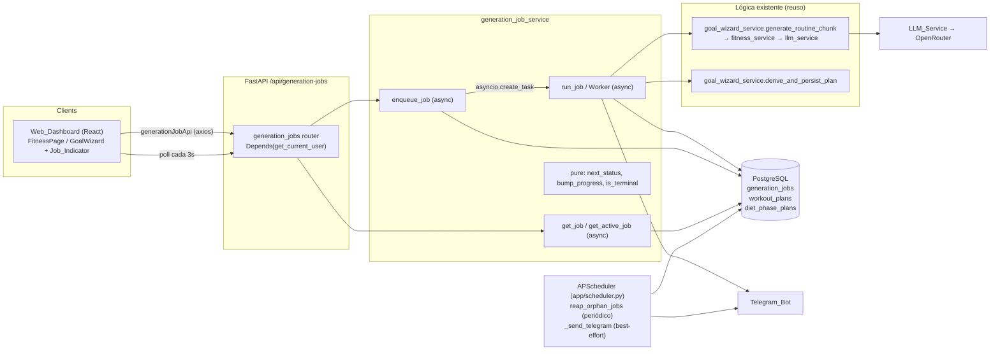
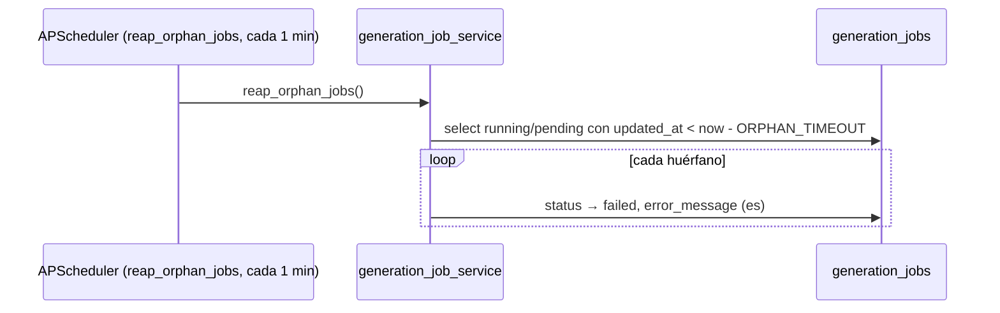
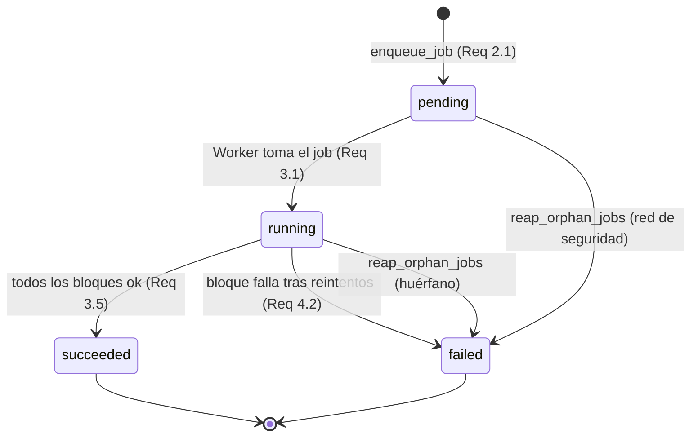
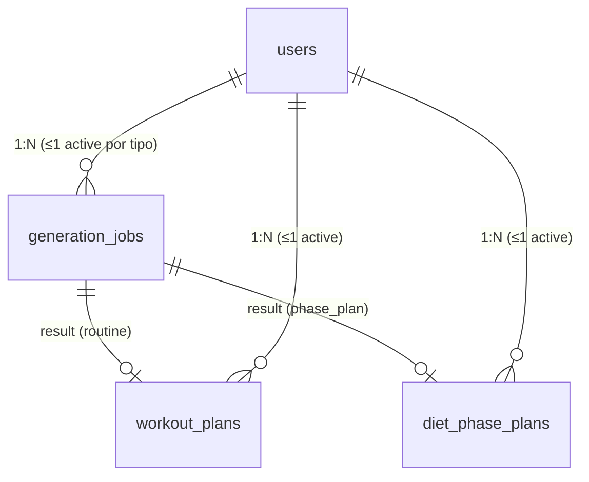

# Design Document: Background Generation

## Overview

La **Background Generation** traslada a segundo plano la generación de rutina y la derivación del plan de objetivo, hoy síncronas y bloqueantes. Sobre la arquitectura existente (FastAPI async + SQLAlchemy 2.0 + PostgreSQL + React 19 + Vite + Tailwind + OpenRouter + APScheduler + Telegram) se introduce lo mínimo necesario:

- Un **nuevo estado de dominio** `GenerationJob` (1:N con el usuario) que registra un trabajo de generación: tipo, estado, progreso por bloque, mensaje de error en español, referencia al resultado y timestamps.
- Una **capa de servicio nueva y delgada** `app/services/generation_job_service.py` con: lógica **pura** de transiciones de estado y progreso, y funciones async que encolan, ejecutan (Worker), consultan y listan trabajos, **reutilizando** el `Chunk_Generator` y el `Phase_Plan_Generator` ya verificados.
- Un conjunto reducido de **endpoints** bajo `/api/generation-jobs` que encolan un trabajo (respuesta inmediata), consultan un trabajo por id (polling) y devuelven el trabajo activo del usuario por tipo.
- El **Worker** in-process: una tarea `asyncio` disparada al encolar, con una **red de seguridad** de APScheduler que recupera trabajos huérfanos (`pending`/`running` colgados tras un reinicio). No se usa Celery/Redis ni colas externas.
- **Cambios de frontend**: los botones "Generar rutina" (`FitnessPage`) y "Realizar objetivo" (`GoalWizard`) encolan el trabajo y liberan al usuario; un `Job_Indicator` persistente consulta el estado por *polling* cada 3 s, muestra el progreso de forma no bloqueante (respetando `prefers-reduced-motion`) y avisa al terminar.

### La realidad del despliegue (explícita en el diseño)

HabitTrack se despliega en **Fly.io (app `habittrack-bot`)** y puede correr con **una sola instancia**. Por eso el Worker se ejecuta **in-process** (misma instancia que sirve la API), que es la opción correcta para este caso: no añade infraestructura, comparte el `AsyncSessionLocal` y el `Scheduler` existentes, y evita la complejidad de una cola distribuida que el alcance no justifica. El costo es que, si la instancia se reinicia a mitad de un trabajo, ese trabajo queda huérfano; esto se mitiga con una red de seguridad de APScheduler que, periódicamente, marca como `failed` los trabajos `running` que llevan demasiado tiempo sin avanzar (ver "Recuperación de trabajos huérfanos"). El escalado a múltiples instancias con coordinación distribuida queda **fuera de alcance** (ver "Futuro / fuera de alcance").

### La realidad del LLM (explícita en el diseño)

La generación de rutina depende del LLM de OpenRouter (modelo gratuito `nvidia/nemotron-3-ultra-550b-a55b:free`), lento (~27 s por bloque pequeño) y poco fiable. Por eso la rutina se genera **por bloques** (hoy 3) y cada bloque **reintenta** como hoy. La Background_Generation **no cambia** esa lógica: el Worker la invoca bloque a bloque y traduce el progreso real a `completed_chunks`. En cambio, el `phase_plan` es **determinista y sin LLM** (`derive_and_persist_plan`), así que su ejecución en segundo plano es rápida y de un solo bloque; se encola igual para unificar el flujo de UI no bloqueante y permitir navegar mientras se deriva.

### Integración con el código existente (dependencia explícita)

| Símbolo existente (verificado) | Uso en la Background_Generation |
| --- | --- |
| `goal_wizard_service.generate_routine_chunk(db, user_id, chunk_index, chunk_count)` | Chunk_Generator: generar un bloque de rutina (Req 3.2). Propaga `LLMError`/`GoalRequiredError`/`EquipmentError` sin cambios. |
| `fitness_service.generate_workout_plan_chunk` / `llm_service.generate_workout_chunk` | Capas internas del Chunk_Generator; reintento por bloque ya existente (Req 4.1). No se tocan. |
| `goal_wizard_service.derive_and_persist_plan(db, user_id)` | Phase_Plan_Generator: derivar y persistir el DietPhasePlan activo (Req 3.4). Determinista, sin LLM. |
| `goal_wizard_service.DISCLAIMER` | Descargo en español reutilizado en respuestas de rutina. |
| `WorkoutPlan` / `WorkoutPlan.active` | Resultado de `routine`; su `id` es la Result_Reference. La acumulación por bloque ya la hace el fitness_service (Req 8.3). |
| `DietPhasePlan` / `DietPhasePlan.active` | Resultado de `phase_plan`; su `id` es la Result_Reference. |
| `app/scheduler.py` (`scheduler`, `start_scheduler`, `_send_telegram`, `_get_chat_id`) | Red de seguridad de trabajos huérfanos (job periódico) y notificación best-effort por Telegram (Req 6.3). |
| `POST /api/goal-plan/routine/generate-chunk` (`RoutineChunkIn`) | Endpoint síncrono existente que se **conserva** sin cambios (Req 8.1). |
| `get_current_user`, `get_db`, `AsyncSessionLocal` | Auth, sesión por request y sesión fuera de request (Worker). |

El flujo síncrono por bloques se conserva intacto: la Background_Generation **añade** una vía asíncrona encima del mismo `Chunk_Generator`, sin modificar su firma ni su contrato (Req 8.1, 8.2).

### Design Decisions clave

| Decisión | Rationale | Requisitos |
| --- | --- | --- |
| **Worker in-process** (asyncio task + red de seguridad APScheduler) en vez de Celery/Redis | Fly.io con 1 instancia; comparte sesión y scheduler existentes; sin infra extra. El alcance no justifica una cola distribuida. | 2.2 |
| **Nueva tabla `generation_jobs`** (no reutilizar WorkoutPlan) | El trabajo tiene ciclo de vida propio (estado, progreso, error, resultado) independiente del plan producido; separa el "proceso" del "resultado". | 1.1 |
| **A lo más un Active_Job por (user, type)** vía *unique partial index* + verificación de servicio | Mismo patrón "a lo más uno activo" del repo (`WorkoutPlan.active`, `DietPhasePlan.active`); el índice parcial garantiza el invariante aun ante carreras. | 2.3, 2.4 |
| **`phase_plan` también se encola** (aunque sea rápido y determinista) | Unifica el flujo de UI no bloqueante y permite navegar mientras se deriva; evita dos caminos distintos en el frontend. | 7.2 |
| **Progreso = `completed_chunks` / `total_chunks`** (enteros) | Representación simple, monótona y verificable; `phase_plan` usa total = 1. | 1.5, 1.6, 3.6, 3.7 |
| **Polling cada 3 s** (no websockets) | Simple y suficiente para trabajos de decenas de segundos; sin estado de conexión. Websockets quedan fuera de alcance. | 5.1, 7.4 |
| **Fallo preserva el plan en construcción** (no `rollback` del WorkoutPlan parcial) | Consistente con el comportamiento actual del Chunk_Generator, que deja el plan acumulado tal cual ante fallo de un bloque posterior. | 4.3, 4.4 |
| **Notificación Telegram best-effort** reutilizando `_send_telegram`/`_get_chat_id` | El bot ya existe; un fallo de red no debe alterar el `succeeded`. | 6.3, 6.4 |
| **Se conserva `generate-chunk`** | Otros flujos/tests dependen de él; la vía async se añade, no reemplaza. | 8.1, 8.2, 8.3 |

## Architecture



Flujo de encolado y ejecución (rutina):

```mermaid
sequenceDiagram
    participant U as Authenticated_User
    participant Web as Web_Dashboard
    participant R as /api/generation-jobs
    participant S as generation_job_service
    participant W as Worker (asyncio)
    participant CG as Chunk_Generator
    participant TG as Telegram_Bot

    U->>Web: "Generar rutina"
    Web->>R: POST / {job_type:"routine", chunk_count:3}
    R->>S: enqueue_job(user, routine, 3)
    alt ya existe Active_Job de ese tipo
        S-->>R: error 409 (es)
        R-->>Web: "Ya hay una generación de rutina en curso."
    else encolado
        S->>S: crear GenerationJob pending (total=3)
        S-)W: asyncio.create_task(run_job(job_id))
        S-->>R: {id, status:"pending", ...}
        R-->>Web: 202 {id}  (no bloquea)
        Web-->>U: puede navegar; Job_Indicator visible
    end

    W->>S: status → running
    loop chunk_index 0..2
        W->>CG: generate_routine_chunk(db, user, i, 3)
        alt éxito
            CG-->>W: WorkoutPlan acumulado
            W->>S: completed_chunks += 1
        else LLMError tras reintentos
            CG-->>W: raise
            W->>S: status → failed, error_message (es)
        end
    end
    opt todos los bloques ok
        W->>S: status → succeeded, result workout_plan_id
        W->>TG: notificar (best-effort)
    end

    loop cada 3s mientras Active_Job
        Web->>R: GET /{id}
        R-->>Web: {status, completed_chunks/total_chunks, error?, result?}
    end
```

Flujo de recuperación de huérfanos (red de seguridad):



## Components and Interfaces

### 1. Data Model (SQLAlchemy 2.0)

Nuevo archivo `app/models/generation_job.py`, registrado en `app/models/__init__.py` e importado en `init_db`.

```python
"""GenerationJob: a background generation task (routine or phase_plan).

Tracks the lifecycle (pending → running → succeeded|failed), per-chunk progress,
a Spanish error message on failure, and a reference to the produced result.
At most one active (pending|running) job per (user, job_type). User-facing text
is Spanish; identifiers and comments are English.
"""
from datetime import datetime
from typing import TYPE_CHECKING

from sqlalchemy import ForeignKey, String, Integer, Text, func, Index
from sqlalchemy.orm import Mapped, mapped_column, relationship

from app.database import Base

if TYPE_CHECKING:
    from app.models.user import User

JOB_TYPES = ("routine", "phase_plan")
JOB_STATUSES = ("pending", "running", "succeeded", "failed")
ACTIVE_STATUSES = ("pending", "running")


class GenerationJob(Base):
    __tablename__ = "generation_jobs"

    id: Mapped[int] = mapped_column(primary_key=True)
    user_id: Mapped[int] = mapped_column(ForeignKey("users.id"), index=True)

    job_type: Mapped[str] = mapped_column(String(20))   # routine | phase_plan
    status: Mapped[str] = mapped_column(String(12), default="pending", index=True)

    completed_chunks: Mapped[int] = mapped_column(Integer, default=0)
    total_chunks: Mapped[int] = mapped_column(Integer, default=1)

    error_message: Mapped[str | None] = mapped_column(Text, nullable=True)  # Spanish
    # Result_Reference: workout_plan_id (routine) or diet_phase_plan_id (phase_plan)
    result_workout_plan_id: Mapped[int | None] = mapped_column(nullable=True)
    result_diet_phase_plan_id: Mapped[int | None] = mapped_column(nullable=True)

    created_at: Mapped[datetime] = mapped_column(default=func.now())
    updated_at: Mapped[datetime] = mapped_column(default=func.now(), onupdate=func.now())

    user: Mapped["User"] = relationship(back_populates="generation_jobs")

    __table_args__ = (
        # At most one ACTIVE job per (user, job_type). Partial unique index on
        # Postgres (status in pending/running). Enforced at the DB layer so the
        # invariant holds even under concurrent enqueue requests.
        Index(
            "uq_active_job_per_user_type",
            "user_id", "job_type",
            unique=True,
            postgresql_where=(status.in_(ACTIVE_STATUSES)),
        ),
    )

    def is_active(self) -> bool:
        return self.status in ACTIVE_STATUSES
```

`User` relationship (edición de `app/models/user.py`, guardada por `TYPE_CHECKING`):

```python
generation_jobs: Mapped[list["GenerationJob"]] = relationship(
    back_populates="user", cascade="all, delete-orphan"
)
```

### 2. `generation_job_service` (`app/services/generation_job_service.py`)

Lógica pura primero (sin I/O), luego funciones async con DB/worker. Las excepciones internas (`ActiveJobExistsError`, `JobNotFoundError`, `GoalRequiredError` reutilizada) las traduce el router a `HTTPException` con `detail` en español.

#### Constantes

```python
DEFAULT_ROUTINE_CHUNKS = 3        # today's chunk_count
PHASE_PLAN_CHUNKS = 1
POLL_INTERVAL_SECONDS = 3         # documented contract with the frontend
ORPHAN_TIMEOUT_MINUTES = 10       # a running/pending job idle longer → failed
ERR_ACTIVE_ROUTINE = "Ya hay una generación de rutina en curso."
ERR_ACTIVE_PHASE = "Ya hay una derivación de tu objetivo en curso."
ERR_JOB_NOT_FOUND = "No encontramos el trabajo solicitado."
ERR_ROUTINE_FAILED = "No pudimos generar tu rutina. Intenta de nuevo."
ERR_PHASE_FAILED = "No pudimos derivar tu objetivo. Intenta de nuevo."
```

#### Funciones puras (estado y progreso)

```python
def is_terminal(status: str) -> bool:
    """PURE. True iff status is a terminal state (succeeded|failed)."""

def is_active(status: str) -> bool:
    """PURE. True iff status is pending or running (an Active_Job)."""

def bump_progress(completed: int, total: int) -> int:
    """PURE. Return the next completed_chunks value: min(completed + 1, total).
    Guarantees the result stays in [0, total] and never decreases (Req 3.6, 3.7)."""

def clamp_progress(completed: int, total: int) -> int:
    """PURE. Return completed clamped into [0, total] (Req 3.7)."""

def total_chunks_for(job_type: str, requested_chunks: int | None) -> int:
    """PURE. total_chunks = requested_chunks (routine, default 3) or 1 (phase_plan)
    (Req 1.5, 1.6)."""

def terminal_status_for_success() -> str:
    """PURE. 'succeeded'."""

def can_enqueue(active_job_status: str | None) -> bool:
    """PURE. True iff there is no Active_Job for this (user, type): active_job_status
    is None or terminal. A failed/succeeded prior job does not block (Req 2.3, 4.5)."""
```

#### Funciones async (DB / Worker)

```python
async def enqueue_job(db, user_id, job_type, chunk_count=None) -> GenerationJob:
    """Create a pending GenerationJob and schedule the Worker.

    - If an Active_Job of this job_type exists → raise ActiveJobExistsError (es)
      (Req 2.3, 2.4). The DB partial unique index is the final guard against races.
    - For job_type 'routine', precondition: a valid weight-target goal exists,
      else raise GoalRequiredError (es) (Req 2.5).
    - total_chunks = total_chunks_for(job_type, chunk_count).
    - Persist the job (status pending), then schedule run_job via
      asyncio.create_task (Req 2.1, 2.2). Returns the job without awaiting it."""

async def run_job(job_id) -> None:
    """Worker body. Opens its OWN AsyncSessionLocal (runs outside the request).

    - Load job; set status running (Req 3.1).
    - routine: for i in 0..total-1 call generate_routine_chunk(db, user, i, total);
      after each success bump_progress and commit (Req 3.2, 3.3). Reintento por
      bloque lo aporta la capa existente (Req 4.1).
    - phase_plan: call derive_and_persist_plan once; completed = 1 (Req 3.4).
    - On full success: status succeeded + Result_Reference (Req 3.5); best-effort
      Telegram notify (Req 6.3, 6.4).
    - On exception: status failed + Spanish error_message; preserve the partial
      plan and the reached completed_chunks (Req 4.2, 4.3, 4.4)."""

async def get_job(db, user_id, job_id) -> GenerationJob:
    """Return the user's own job by id, else raise JobNotFoundError (es). A job of
    another user is reported as not found (no data leak) (Req 5.1, 5.2, 5.3)."""

async def get_active_job(db, user_id, job_type) -> GenerationJob | None:
    """Return the user's Active_Job of job_type, or None (Req 5.5)."""

async def reap_orphan_jobs(db) -> int:
    """Safety net (APScheduler): mark as failed every active job whose updated_at
    is older than ORPHAN_TIMEOUT_MINUTES, with a Spanish error_message. Returns the
    number of jobs reaped. Idempotent (acts once per job)."""
```

### 3. Endpoints (`app/routes/generation_jobs.py`, prefix `/api/generation-jobs`)

Todos con `current_user: User = Depends(get_current_user)`; los datos se filtran por `current_user.id`. Registrado en `main.py`: `from app.routes import generation_jobs` + `app.include_router(generation_jobs.router, prefix="/api/generation-jobs", tags=["BackgroundGeneration"])`.

| Método | Ruta | Request | Response | Requisitos |
| --- | --- | --- | --- | --- |
| POST | `/` | `EnqueueIn{job_type, chunk_count?}` | `202` `JobOut{id, job_type, status, completed_chunks, total_chunks, result?, error_message?}` | 2.1–2.5 |
| GET | `/{job_id}` | — | `JobOut` | 5.1–5.4 |
| GET | `/active?job_type=routine` | — | `JobOut` o `{message}` | 5.5 |

`JobOut` (Pydantic): `id:int`, `job_type:str`, `status:str`, `completed_chunks:int`, `total_chunks:int`, `result_workout_plan_id:int|None`, `result_diet_phase_plan_id:int|None`, `error_message:str|None`.

Mapeo de errores en el router:
- `ActiveJobExistsError` → `409 Conflict`, detail en español (`ERR_ACTIVE_*`).
- `GoalRequiredError` → `400 Bad Request`, detail en español.
- `JobNotFoundError` → `404 Not Found`, detail `ERR_JOB_NOT_FOUND`.
- Cualquier otra excepción inesperada → se registra con `logging.exception` y se devuelve un `500`/`502` con mensaje en español genérico.

Ejemplo `POST /api/generation-jobs` → `202`:
```json
{"id": 42, "job_type": "routine", "status": "pending",
 "completed_chunks": 0, "total_chunks": 3,
 "result_workout_plan_id": null, "result_diet_phase_plan_id": null,
 "error_message": null}
```
Ejemplo `GET /api/generation-jobs/active?job_type=phase_plan` sin trabajo:
`{"message": "No tienes una generación en curso de este tipo."}`.

### 4. Worker in-process y red de seguridad

- **Disparo inmediato**: `enqueue_job` llama `asyncio.create_task(run_job(job.id))`. `run_job` abre su **propia** `AsyncSessionLocal` (no la sesión del request, que se cierra al responder) y hace commits incrementales por bloque, de modo que el polling vea el progreso.
- **Red de seguridad (APScheduler)**: en `app/scheduler.py`, un job nuevo `reap_orphan_jobs` con `IntervalTrigger(minutes=1)` marca `failed` los trabajos `running`/`pending` cuyo `updated_at` quedó rezagado más de `ORPHAN_TIMEOUT_MINUTES` (p.ej. tras un reinicio de la instancia). Es idempotente y actúa una sola vez por trabajo. Se registra en `start_scheduler()` junto a los jobs existentes.
- **Notificación**: al pasar a `succeeded`, `run_job` reutiliza `scheduler._get_chat_id` + `scheduler._send_telegram` (o helpers equivalentes) dentro de un `try/except` que registra y descarta cualquier fallo de red (best-effort), sin alterar el `succeeded` (Req 6.4).

### 5. Frontend

**`src/lib/api.ts`** — añadir `generationJobApi` + interfaces TS:

```typescript
export type JobType = 'routine' | 'phase_plan'
export type JobStatus = 'pending' | 'running' | 'succeeded' | 'failed'
export interface GenerationJob {
  id: number; job_type: JobType; status: JobStatus
  completed_chunks: number; total_chunks: number
  result_workout_plan_id: number | null
  result_diet_phase_plan_id: number | null
  error_message: string | null
}
export const generationJobApi = {
  enqueue: (d: { job_type: JobType; chunk_count?: number }) =>
    api.post<GenerationJob>('/generation-jobs', d),
  get: (id: number) => api.get<GenerationJob>(`/generation-jobs/${id}`),
  getActive: (job_type: JobType) =>
    api.get<GenerationJob | { message: string }>(`/generation-jobs/active`, { params: { job_type } }),
}
```

**`src/hooks/useGenerationJob.ts`** (hook nuevo) — encapsula el ciclo encolar → *polling* → terminal:
- `enqueue(job_type)`: llama `generationJobApi.enqueue`, guarda el `id` y arranca el *polling*.
- *Polling* cada `POLL_INTERVAL_SECONDS` (3 s) con `setInterval`, deteniéndose cuando `status` es terminal (`succeeded`/`failed`).
- Al montar, llama `getActive(job_type)` para **reanudar** un Active_Job tras recargar la página (Req 7.6).
- Expone `{ job, progress, isActive, isDone, error, enqueue }`.

**`src/components/JobIndicator.tsx`** (componente nuevo, persistente) — barra/indicador flotante montado en el layout raíz (`App`/layout) para que sobreviva a la navegación entre páginas (Req 7.3). Muestra:
- `running`: progreso `completed_chunks/total_chunks` en español ("Generando rutina… bloque 2 de 3"). Si `prefers-reduced-motion` está activo, muestra el porcentaje/estado como texto estático sin animación (Req 7.5).
- `succeeded`: aviso en español + acción "Ver resultado" que navega a la página correspondiente (Req 6.1).
- `failed`: aviso en español con `error_message` + acción "Reintentar" que vuelve a encolar (Req 6.2).
Usa `window.matchMedia('(prefers-reduced-motion: reduce)')` para decidir la variante.

**`src/pages/FitnessPage.tsx`** — el botón "Generar rutina" ahora llama `enqueue('routine')` (del hook) en lugar del bucle síncrono `generateRoutineChunk(i, 3)`; tras encolar, el usuario puede navegar y el `JobIndicator` toma el relevo.

**`src/components/GoalWizard.tsx`** (`RoutineStep`) — el paso de rutina y el botón "Realizar objetivo" encolan (`enqueue('routine')` / `enqueue('phase_plan')`) en vez de bloquear con la barra; el `JobIndicator` muestra el progreso de forma no bloqueante.

Estilo: Tailwind dark con los tokens establecidos del proyecto (`card`, `btn-primary`, `btn-ghost`, `text-text-primary/secondary/dim`, `accent`, `success`, `font-display`), coherente con `FitnessPage`.

### 6. Migración

Dos redes de seguridad, consistente con el proyecto:
1. **`create_all` idempotente**: importar `generation_job` en `init_db` y registrar `GenerationJob` en `app/models/__init__.py`. `create_all` crea `generation_jobs` (y sus índices) si no existe.
2. **Migración Alembic** encadenada tras `20260614_100000`: `create_table("generation_jobs", ...)` con índice en `user_id`, índice en `status` y el **índice único parcial** `uq_active_job_per_user_type` (`unique=True`, `postgresql_where=status.in_(('pending','running'))`). Como es una tabla nueva, no requiere entrada en `_migrate_columns` (que solo cubre ALTER TABLE de tablas existentes).

## Data Models

### Tabla nueva: `generation_jobs`

| Columna | Tipo | Notas |
| --- | --- | --- |
| id | PK int | |
| user_id | FK users.id, index | 1:N (Req 1.1) |
| job_type | str(20) | `routine` \| `phase_plan` (Req 1.3) |
| status | str(12), index, default `pending` | `pending`\|`running`\|`succeeded`\|`failed` (Req 1.2, 1.4) |
| completed_chunks | int, default 0 | Progress; monótono no decreciente, en `[0, total_chunks]` (Req 3.6, 3.7) |
| total_chunks | int, default 1 | `routine`=Chunk_Count (3); `phase_plan`=1 (Req 1.5, 1.6) |
| error_message | text, nullable | mensaje en español al fallar (Req 4.2, 5.4) |
| result_workout_plan_id | int, nullable | Result_Reference de `routine` (Req 3.5, 5.1) |
| result_diet_phase_plan_id | int, nullable | Result_Reference de `phase_plan` (Req 3.5, 5.1) |
| created_at / updated_at | datetime | `updated_at` alimenta la recuperación de huérfanos |

Índices:
- `ix_generation_jobs_user_id` (user_id), `ix_generation_jobs_status` (status).
- `uq_active_job_per_user_type` — **único parcial** sobre `(user_id, job_type)` donde `status in ('pending','running')`: a lo más un Active_Job por (usuario, tipo) (Req 2.3, 2.4).

### Transiciones de estado (máquina de estados)



`pending` y `running` son Active_Job; `succeeded` y `failed` son terminales. Desde un terminal no hay transiciones: un nuevo intento crea **otro** GenerationJob (Req 4.5).

### Relaciones



## Correctness Properties

*A property is a characteristic or behavior that should hold true across all valid executions of a system-essentially, a formal statement about what the system should do. Properties serve as the bridge between human-readable specifications and machine-verifiable correctness guarantees.*

Estas propiedades aplican a la lógica **pura** de estado y progreso (`total_chunks_for`, `bump_progress`, `clamp_progress`, `can_enqueue`, `is_active`/`is_terminal`), a los invariantes de estado persistido (a lo más un Active_Job por usuario y tipo; preservación ante fallo; privacidad entre usuarios) y a la equivalencia del Worker con el flujo síncrono. Las capas de I/O (LLM, render del Job_Indicator, auth, notificación Telegram) y las comprobaciones de esquema/configuración se cubren con tests de ejemplo/integración/componente (ver Testing Strategy).

Tras la prework se realizó una reflexión para eliminar redundancia: la inicialización (1.2) queda como Property 1; el mapeo de `total_chunks` (1.5, 1.6) se agrupa en la Property 2; la monotonía y las cotas del progreso junto con el conteo por bloque y la no reducción al fallar (3.3, 3.6, 3.7, 4.4) se agrupan en la Property 3; el invariante de a lo más un Active_Job y el predicado de encolado (2.3, 2.4, 4.5) se agrupan en la Property 4; el conteo exacto de invocaciones del Chunk_Generator (3.2) se agrupa dentro de la equivalencia de la Property 9.

### Property 1: Inicialización del trabajo

*For any* usuario válido y Job_Type válido, el Generation_Job recién encolado debe tener Job_Status `pending`, bloques completados en cero y Result_Reference nula.

**Validates: Requirements 1.2**

### Property 2: Mapeo de bloques totales por tipo

*For any* número de bloques solicitado, `total_chunks_for` debe devolver ese número solicitado cuando el Job_Type es `routine` y debe devolver exactamente uno cuando el Job_Type es `phase_plan`.

**Validates: Requirements 1.5, 1.6**

### Property 3: Monotonía y cotas del progreso

*For any* valor inicial de bloques completados, cualquier número total de bloques y cualquier cantidad de avances aplicados (incluido el caso de una ejecución que falla en un bloque intermedio), los bloques completados resultantes deben permanecer entre cero y el total inclusive, no deben decrecer respecto del valor anterior, y tras `k` bloques completados con éxito deben valer exactamente `k`.

**Validates: Requirements 3.3, 3.6, 3.7, 4.4**

### Property 4: A lo más un trabajo activo por usuario y tipo

*For any* usuario, cualquier Job_Type y cualquier secuencia de intentos de encolado, en todo momento debe existir a lo más un Active_Job de ese Job_Type para ese usuario: un intento de encolar mientras ya hay un Active_Job del mismo tipo debe rechazarse conservando el Active_Job existente, y `can_enqueue` debe permitir el encolado si y solo si no hay Active_Job (es decir, el trabajo previo es inexistente o terminal).

**Validates: Requirements 2.3, 2.4, 4.5**

### Property 5: Éxito fija estado terminal y referencia al resultado

*For any* número total de bloques, una ejecución del Worker en la que todos los bloques se completan con éxito debe terminar con Job_Status `succeeded` y con la Result_Reference apuntando al plan producido (el `workout_plan_id` para `routine` o el `diet_phase_plan_id` para `phase_plan`).

**Validates: Requirements 3.5**

### Property 6: El fallo marca estado fallido con mensaje en español

*For any* número total de bloques y cualquier posición de bloque en la que la generación falle tras agotar sus reintentos, el Generation_Job debe terminar con Job_Status `failed` y con un mensaje de error en español no vacío.

**Validates: Requirements 4.2**

### Property 7: El fallo preserva el plan en construcción

*For any* posición de bloque en la que una ejecución de rutina falle, el WorkoutPlan acumulado tras el fallo debe ser igual al plan acumulado tras los bloques que sí se completaron con éxito antes del fallo, sin perder esos bloques previos ni dejar datos corruptos.

**Validates: Requirements 4.3**

### Property 8: Aislamiento entre usuarios al consultar

*For any* par de usuarios distintos y cualquier Generation_Job perteneciente a uno de ellos, la consulta de ese trabajo por el otro usuario debe señalar que el trabajo no fue encontrado y no debe devolver ningún dato del trabajo.

**Validates: Requirements 5.3**

### Property 9: Equivalencia del Worker con la generación síncrona por bloques

*For any* número total de bloques de rutina, con las mismas salidas de bloque, la ejecución del Worker debe invocar al Chunk_Generator exactamente ese número de veces con los índices de bloque de cero hasta el total menos uno y producir el mismo WorkoutPlan activo acumulado que produce la secuencia equivalente de llamadas síncronas a la generación por bloques con el mismo Chunk_Count.

**Validates: Requirements 3.2, 8.3**

### Property 10: La notificación best-effort no altera el éxito

*For any* fallo del envío de la notificación por el Telegram_Bot, el Generation_Job que ya alcanzó Job_Status `succeeded` debe conservar ese estado sin alterarlo.

**Validates: Requirements 6.4**

## Error Handling

El manejo de errores sigue el patrón del proyecto: excepciones de dominio en el servicio, traducidas a `HTTPException` con `detail` en español en el router; el cliente axios muestra ese `detail`. Las capas de I/O (LLM, Telegram) nunca exponen trazas internas al usuario.

| Situación | Dónde | Resultado | Requisitos |
| --- | --- | --- | --- |
| Encolar con Active_Job del mismo tipo | `enqueue_job` → `ActiveJobExistsError` | `409`, `ERR_ACTIVE_ROUTINE`/`ERR_ACTIVE_PHASE` (español); el Active_Job existente se conserva | 2.3, 2.4 |
| Encolar `routine` sin objetivo de peso válido | `enqueue_job` → `GoalRequiredError` (reusada) | `400`, mensaje en español "completa tu objetivo…" | 2.5 |
| Carrera de dos encolados simultáneos del mismo tipo | Índice único parcial `uq_active_job_per_user_type` en Postgres | el segundo `INSERT` viola el índice → se traduce a `ActiveJobExistsError` (`409`, español) | 2.3, 2.4 |
| Fallo de un bloque de rutina tras reintentos | `run_job` captura `LLMError`/`Exception` | Job_Status `failed`, `error_message = ERR_ROUTINE_FAILED`; plan parcial y `completed_chunks` preservados; se registra con `logging.exception` | 4.2, 4.3, 4.4 |
| Fallo del `phase_plan` (p.ej. `GoalRequiredError` dentro del Worker) | `run_job` captura la excepción | Job_Status `failed`, `error_message = ERR_PHASE_FAILED` (o el `detail` de dominio si aplica) | 4.2, 4.3 |
| Consultar un trabajo inexistente | `get_job` → `JobNotFoundError` | `404`, `ERR_JOB_NOT_FOUND` (español) | 5.2 |
| Consultar un trabajo de otro usuario | `get_job` (filtra por `user_id`) → `JobNotFoundError` | `404`, `ERR_JOB_NOT_FOUND` (no revela datos ajenos) | 5.3 |
| Trabajo huérfano tras reinicio de la instancia | `reap_orphan_jobs` (APScheduler) | Job_Status `failed` + `error_message` en español; idempotente, una vez por trabajo | — (red de seguridad) |
| Fallo al notificar por Telegram | `run_job` (bloque `try/except` best-effort) | se registra y se descarta; el Job_Status `succeeded` no cambia | 6.3, 6.4 |
| Error inesperado en cualquier endpoint | router (`except Exception`) | `logging.exception` + `500`/`502` con mensaje genérico en español, sin traza interna | — |

## Testing Strategy

Enfoque dual, consistente con el repo (pytest + pytest-asyncio + Hypothesis en `tests/`; `pytest.ini` en la raíz; marcadores `unit`, `integration`, `asyncio`). Los **property tests** cubren invariantes universales; los **unit/example/integration tests** cubren ejemplos concretos, bordes, I/O y wiring.

### Dónde aplica PBT y dónde no

- **Aplica PBT** a la lógica pura y a los invariantes de estado: mapeo de `total_chunks`, monotonía/cotas del progreso, a lo más un Active_Job por (usuario, tipo), inicialización, estado terminal ante éxito/fallo, preservación del plan ante fallo, aislamiento entre usuarios y equivalencia Worker↔síncrono (con el Chunk_Generator/LLM **mockeado** para hacerlo determinista y barato). Son funciones y transiciones con amplio espacio de entrada (total de bloques, posición de fallo, pares de usuarios, secuencias de encolado) donde 100+ iteraciones encuentran bordes.
- **No aplica PBT** y se usan ejemplos/integración/componente para: la generación real por LLM (`llm_service`, lento y no determinista → se mockea), la notificación por Telegram (side-effect externo → mock), el render del `Job_Indicator` y las interacciones de UI (componente/DOM), el *polling* por tiempo (fake timers), la validación de esquema de endpoints y la no-regresión del endpoint `generate-chunk`.

### Herramientas

- **Property-based**: **Hypothesis** (ya presente en el repo, `.hypothesis/`). Cada property test se configura con **mínimo 100 iteraciones** (`@settings(max_examples=100)`), con el Chunk_Generator/LLM mockeado donde el Worker intervenga.
- **Async**: `pytest-asyncio` (auto mode) para el Worker y las funciones de servicio async.
- **DB**: sesión de test async (como en los tests existentes) para los invariantes persistidos (a lo más un Active_Job, aislamiento entre usuarios).
- **Frontend** (si el repo añade tests de componente): render del `JobIndicator` y del hook con *fake timers* y `matchMedia` mockeado; de lo contrario, se documentan como ejemplos manuales fuera de alcance de CI.

### Mapeo de propiedades a tests

Cada property test debe referenciar su propiedad del diseño con el tag:
**Feature: background-generation, Property {número}: {texto}**

| Property | Tipo de test | Notas |
| --- | --- | --- |
| 1 Inicialización | property (servicio async) | `enqueue_job` sobre datos generados → estado inicial exacto |
| 2 Mapeo de bloques totales | property (pura) | `total_chunks_for` sobre `n` generado y ambos tipos |
| 3 Monotonía/cotas del progreso | property (pura) | `bump_progress`/`clamp_progress` sobre secuencias generadas |
| 4 A lo más un Active_Job | property (servicio async + DB) | secuencias de encolado; `can_enqueue` sobre estados previos |
| 5 Éxito → terminal + resultado | property (Worker, generador mockeado) | varía `total` |
| 6 Fallo → `failed` + mensaje es | property (Worker, generador mockeado) | varía `total` y posición de fallo |
| 7 Fallo preserva el plan | property (Worker + DB, generador mockeado) | plan tras fallo == plan tras `k` éxitos |
| 8 Aislamiento entre usuarios | property (servicio async + DB) | pares de usuarios generados |
| 9 Equivalencia Worker↔síncrono | property (Worker vs secuencia, generador mockeado) | conteo de invocaciones + estructura acumulada |
| 10 Notificación no altera éxito | property (Worker, notificador que lanza) | cualquier excepción del notifier |

### Unit / example / integration tests

- **Endpoints**: forma de `JobOut`, códigos de estado (`202`, `404`, `409`, `400`), mensajes en español (5.1, 5.2, 5.4, 2.5, 1.3).
- **Worker**: `pending→running` antes de generar (3.1); `phase_plan` invoca una vez y queda `completed=1` (3.4).
- **Red de seguridad**: `reap_orphan_jobs` marca `failed` un trabajo `running` rezagado e ignora los recientes.
- **No-regresión**: el test existente de `POST /api/goal-plan/routine/generate-chunk` sigue pasando sin cambios (8.1, 8.2); los 147 tests actuales deben seguir verdes.
- **Telegram**: con `telegram_chat_id`, al llegar a `succeeded` el notificador se invoca una vez (mock) (6.3).
- **Frontend (componente)**: `JobIndicator` muestra "Ver resultado" en `succeeded` (6.1) y "Reintentar" + error en `failed` (6.2); variante estática bajo `prefers-reduced-motion` (7.5); el hook reanuda vía `getActive` al montar (7.6) y hace *polling* cada 3 s con *fake timers* (7.4).

### Balance

Pocos unit tests, enfocados en ejemplos y bordes que las propiedades no cubren (mensajes concretos en español, códigos HTTP, wiring de UI/Telegram). Las propiedades cubren la variación de entrada (total de bloques, posición de fallo, secuencias de encolado, pares de usuarios). Los tests de property del Worker mockean `generate_routine_chunk`/`derive_and_persist_plan` para ser deterministas y baratos, sin llamar al LLM real.

## Futuro / fuera de alcance

- **Escalado multi-instancia**: coordinación distribuida (cola externa Celery/Redis, *leader election* o bloqueos a nivel de fila para que solo una instancia tome cada trabajo). Hoy se asume una sola instancia de Fly.io con Worker in-process.
- **Tiempo real**: *websockets* o notificaciones *push* del navegador en lugar de *polling*.
- **Cancelación**: permitir al usuario cancelar un Active_Job en curso.
- **Historial**: más allá del Active_Job y el último terminado por tipo (p.ej. una bitácora completa de trabajos).
- **Encolado desde Telegram**: iniciar generaciones desde el bot.
- **Meal plan día a día** en segundo plano.
