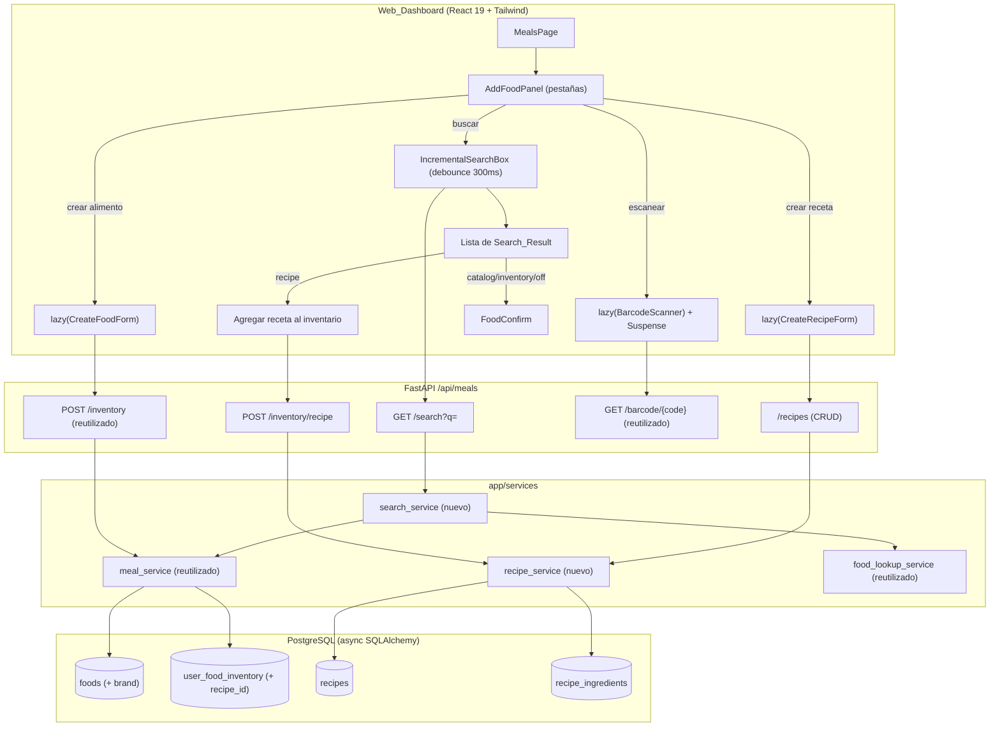

# Design Document: Food Add Redesign

## Overview

El Food_Add_Redesign rediseña la experiencia de "Agregar alimento" de la Meals_Page construyendo sobre *meal-planner* y *food-barcode* sin reimplementarlos. Reúne cinco cambios:

1. Una **búsqueda incremental unificada** que, con un retardo (Search_Debounce) de 300 ms, consulta en una sola llamada el catálogo local, el inventario del usuario, sus recetas y, como respaldo, Open Food Facts por nombre.
2. Un **formulario de alta dinámico** (Create_Food_Form), cargado de forma diferida e inline (sin modal).
3. Una **marca** (`brand`) opcional en `Food`.
4. **Recetas** (`Recipe` + `Recipe_Ingredient`) con nutrición agregada derivada de sus ingredientes, buscables y agregables al inventario como una unidad.
5. Un **escáner de carga diferida**: el Barcode_Scanner solo se importa y monta cuando el usuario elige escanear.

El diseño reutiliza directamente: `Food`, `UserFoodInventory`, `validate_food_fields`, `create_food`, `add_inventory`, `_normalize_name`, `food_lookup_service.search_by_name`, el endpoint de lookup por barcode y el componente `BarcodeScanner`. La extensión del modelo de datos es mínima: una columna `brand` en `Food` y dos tablas nuevas (`recipes`, `recipe_ingredients`). Todo el backend es async con `Depends(get_db)` y rutas bajo `/api/meals`; las cadenas de cara al usuario son en español y los identificadores en inglés.

### Investigación y decisiones

- **Reutilización del lookup externo.** `food_lookup_service.search_by_name` ya devuelve una lista de candidatos best-effort (nunca lanza, devuelve `[]` ante fallo) e incluye `brand` e `image_url`. La búsqueda unificada lo reutiliza sin cambios y solo lo invoca cuando no hay resultados locales, replicando el criterio del endpoint `food-search` existente (Req 2.2, 2.6).
- **Marca en Food.** `food-barcode` ya mapea `brands` de Open Food Facts a `Food_Candidate.brand`, pero el modelo `Food` no la persiste (ver `app/models/food.py`). Se añade `brand: Mapped[str | None]` (máx. 100). Se reutiliza el mismo patrón de migración de `20260613_100000_add_food_barcode.py` (más el "safety net" de `_migrate_columns` en `init_db`).
- **Recetas como extensión, no como Food.** Una Recipe no es un Food: sus ingredientes cambian y su nutrición es derivada. Modelarla como tablas propias evita contaminar el catálogo global y mantiene la privacidad por usuario. El inventario puede referenciar una Recipe mediante una FK anulable adicional (`recipe_id`), de modo que una entrada de inventario apunta a un Food **o** a una Recipe.
- **Nutrición agregada pura.** El cálculo de `Recipe_Nutrition` es una función pura sobre `(ingredientes, nutrición por 100 g de cada Food)`, ideal para property-based testing (invariante de suma ponderada).
- **Carga diferida en React 19.** `React.lazy` + `Suspense` permiten importar `BarcodeScanner` solo cuando se activa la pestaña de escanear; el `fallback` muestra el indicador de carga en español (Req 6.2, 6.3). El componente ya libera la cámara en `useEffect cleanup` al desmontarse (Req 6.5).
- **Inspiración MapMyFitness.** El flujo de "agregar alimento" de MapMyFitness usa una barra de búsqueda prominente con pestañas (Todo / Mis alimentos / Recetas) y un acceso a escanear. Se adopta esa *distribución* (una búsqueda prominente + acciones por pestaña + crear nuevo), a la manera de HabitTrack, sin copiar su UI. No fue necesario inspeccionar binarios con REA.

## Architecture



La capa web decide **qué** cargar (lazy) y **cuándo** (al activar la pestaña). El backend añade dos servicios: `search_service` (orquesta la Incremental_Search) y `recipe_service` (CRUD de recetas y nutrición agregada). Ambos reutilizan `meal_service` (`validate_food_fields`, `add_inventory`, `_normalize_name`) y `food_lookup_service`.

## Components and Interfaces

### Backend — nuevos endpoints (prefijo `/api/meals`)

| Método | Ruta | Auth | Descripción | Requisitos |
|---|---|---|---|---|
| GET | `/search?q=` | `get_current_user` | Incremental_Search unificada (catálogo + inventario + recetas + OFF fallback) | 2.1–2.3, 2.5–2.7, 8.1, 8.5 |
| GET | `/recipes` | `get_current_user` | Lista las Recipe del usuario con su Recipe_Nutrition | 4.5, 8.1, 8.5 |
| POST | `/recipes` | `get_current_user` | Crea una Recipe con sus Recipe_Ingredient | 4.1, 4.3, 4.4, 8.1 |
| DELETE | `/recipes/{recipe_id}` | `get_current_user` | Elimina una Recipe propia | 4.6, 8.4 |
| POST | `/inventory/recipe` | `get_current_user` | Agrega una Recipe propia al inventario como unidad | 5.1–5.4, 8.1 |

Endpoints **reutilizados sin cambios**: `GET /barcode/{code}`, `POST /inventory`, `POST /foods` (admin), `PUT/DELETE /foods/{id}` (admin). La separación de privilegios se conserva (Req 8.2).

### Backend — esquemas Pydantic (en `app/routes/meals.py`)

```python
class SearchResultOut(BaseModel):
    kind: str                 # "catalog" | "inventory" | "recipe" | "off"
    id: int | None = None     # food_id o recipe_id (None para "off")
    name: str
    brand: str | None = None
    kcal: float | None = None
    protein: float | None = None
    fat: float | None = None
    carbs: float | None = None
    fiber: float | None = None
    barcode: str | None = None
    image_url: str | None = None

class RecipeIngredientIn(BaseModel):
    food_name: str
    grams: float

class RecipeIn(BaseModel):
    name: str
    ingredients: list[RecipeIngredientIn]

class RecipeIngredientOut(BaseModel):
    food_id: int
    food_name: str
    grams: float

class RecipeNutritionOut(BaseModel):
    kcal: float
    protein: float
    fat: float
    carbs: float
    fiber: float | None

class RecipeOut(BaseModel):
    id: int
    name: str
    ingredients: list[RecipeIngredientOut]
    nutrition: RecipeNutritionOut

class InventoryRecipeIn(BaseModel):
    recipe_id: int
    quantity_grams: float
```

### Backend — `app/services/search_service.py` (nuevo)

```python
async def unified_search(db, user_id, q) -> list[dict]:
    """Return Search_Result dicts (Req 2). Validates term length (1..100);
    searches catalog (ilike), the user's inventory, and the user's recipes;
    when there are no local results, falls back to food_lookup_service.
    search_by_name (best-effort). Scoped to user_id (Req 2.7, 8.1)."""
```

### Backend — `app/services/recipe_service.py` (nuevo)

```python
def compute_recipe_nutrition(ingredients: list[dict]) -> dict:
    """PURE. ingredients: [{grams, kcal_per_100g, protein_g_per_100g,
    fat_g_per_100g, carbs_g_per_100g, fiber_g_per_100g|None}]. Returns per-100g
    nutrition = (sum over i of value_i/100 * grams_i) / total_grams * 100.
    fiber is None only if every ingredient's fiber is None (Req 4.2)."""

async def create_recipe(db, user_id, name, ingredients) -> Recipe: ...   # Req 4.1,4.3,4.4
async def list_recipes(db, user_id) -> list[Recipe]: ...                  # Req 4.5
async def delete_recipe(db, user_id, recipe_id) -> None: ...              # Req 4.6,8.4
async def add_recipe_to_inventory(db, user_id, recipe_id, grams): ...     # Req 5.1-5.4
```

El servicio reutiliza `validate_food_fields` (indirectamente vía el catálogo), `_normalize_name` para el matching por nombre de ingrediente, y el rango `INVENTORY_GRAMS_RANGE` (1..100000) de `meal_service` para validar gramos.

### Frontend — componentes

- `AddFoodPanel.tsx` (nuevo): el panel con pestañas (escanear / buscar / inventario / recetas / crear). Gestiona la pestaña activa y respeta `prefers-reduced-motion` (Req 7.1, 7.2, 7.5).
- `IncrementalSearchBox.tsx` (nuevo): input con debounce de 300 ms (`useEffect` + `setTimeout` + cleanup), llama a `mealsApi.search(q)` y renderiza `Search_Result` (Req 2.4, 7.6).
- `CreateRecipeForm.tsx` (nuevo, lazy): selección de ingredientes (Food) con gramos; muestra la nutrición agregada estimada (Req 4).
- `BarcodeScanner.tsx` (reutilizado): importado vía `React.lazy` solo al activar la pestaña escanear (Req 6).
- `FoodConfirm.tsx` / `FoodSearchBox.tsx` (reutilizados): el paso de confirmación de `Food_Candidate`.
- `MealsPage.tsx` (modificado): reemplaza las listas completas y el formulario siempre visible por el `AddFoodPanel`.

### Frontend — cliente API (`src/lib/api.ts`)

```typescript
export interface SearchResult { kind: 'catalog'|'inventory'|'recipe'|'off'; id?: number|null;
  name: string; brand?: string|null; kcal?: number|null; protein?: number|null;
  fat?: number|null; carbs?: number|null; fiber?: number|null; barcode?: string|null; image_url?: string|null }
export interface Recipe { id: number; name: string;
  ingredients: { food_id: number; food_name: string; grams: number }[];
  nutrition: { kcal: number; protein: number; fat: number; carbs: number; fiber: number|null } }

mealsApi.search      = (q: string) => api.get<SearchResult[]>(`/meals/search?q=${encodeURIComponent(q)}`)
mealsApi.listRecipes = () => api.get<Recipe[]>('/meals/recipes')
mealsApi.createRecipe= (d) => api.post<Recipe>('/meals/recipes', d)
mealsApi.deleteRecipe= (id) => api.delete(`/meals/recipes/${id}`)
mealsApi.addRecipeToInventory = (d) => api.post('/meals/inventory/recipe', d)
```

Carga diferida del escáner:

```tsx
const BarcodeScanner = React.lazy(() =>
  import('../components/BarcodeScanner').then(m => ({ default: m.BarcodeScanner })))
// ...
{tab === 'scan' && (
  <Suspense fallback={<p className="text-sm text-text-dim">Cargando escáner…</p>}>
    <BarcodeScanner onDetected={handleBarcode} />
  </Suspense>
)}
```

## Data Models

### `Food` (modificado) — `app/models/food.py`

Se añade una columna; todo lo demás (incluidas las banderas `is_meat`, `is_animal`, `has_gluten`) **se conserva tal cual**.

```python
brand: Mapped[str | None] = mapped_column(String(100), nullable=True)  # optional brand (Req 1)
```

### `Recipe` (nuevo) — `app/models/recipe.py`

```python
class Recipe(Base):
    __tablename__ = "recipes"
    __table_args__ = (UniqueConstraint("user_id", "name", name="uq_user_recipe_name"),)
    id: Mapped[int] = mapped_column(primary_key=True)
    user_id: Mapped[int] = mapped_column(ForeignKey("users.id"), index=True)  # owner (private)
    name: Mapped[str] = mapped_column(String(100))                            # 1..100 chars
    created_at: Mapped[datetime] = mapped_column(default=func.now())
    ingredients: Mapped[list["RecipeIngredient"]] = relationship(
        back_populates="recipe", cascade="all, delete-orphan")
```

### `RecipeIngredient` (nuevo) — `app/models/recipe_ingredient.py`

```python
class RecipeIngredient(Base):
    __tablename__ = "recipe_ingredients"
    id: Mapped[int] = mapped_column(primary_key=True)
    recipe_id: Mapped[int] = mapped_column(ForeignKey("recipes.id", ondelete="CASCADE"), index=True)
    food_id: Mapped[int] = mapped_column(ForeignKey("foods.id"), index=True)
    grams: Mapped[float] = mapped_column(Float)   # 1..100000
    recipe: Mapped["Recipe"] = relationship(back_populates="ingredients")
    food: Mapped["Food"] = relationship()
```

### `UserFoodInventory` (modificado) — `app/models/user_food_inventory.py`

Se añade una FK anulable a `recipes` para que una entrada apunte a un Food **o** a una Recipe (Req 5.1). `food_id` pasa a ser anulable; se añade un `CheckConstraint` "exactamente uno de food_id / recipe_id".

```python
food_id: Mapped[int | None] = mapped_column(ForeignKey("foods.id"), index=True, nullable=True)
recipe_id: Mapped[int | None] = mapped_column(ForeignKey("recipes.id"), index=True, nullable=True)
# __table_args__: UniqueConstraint(user_id, food_id), UniqueConstraint(user_id, recipe_id),
#                 CheckConstraint("(food_id IS NOT NULL) <> (recipe_id IS NOT NULL)")
```

Los modelos nuevos se exportan en `app/models/__init__.py` (`Recipe`, `RecipeIngredient`). Migración Alembic nueva (`20260615_100000_add_recipes_and_food_brand`) encadenada tras `20260614_100000`, siguiendo el estilo de las migraciones existentes.

## Correctness Properties

*A property is a characteristic or behavior that should hold true across all valid executions of a system — essentially, a formal statement about what the system should do. Properties serve as the bridge between human-readable specifications and machine-verifiable correctness guarantees.*

Las propiedades siguientes se derivan de la prework de los criterios de aceptación. Los criterios de UI (debounce, carga diferida, pestañas, `prefers-reduced-motion`), el cableado de autorización y las ramas que dependen de Open Food Facts se verifican con tests de ejemplo/integración (ver Testing Strategy), no como propiedades.

### Property 1: Toda entrada inválida se rechaza y preserva el estado

*Para toda* marca de más de 100 caracteres, *para todo* término de búsqueda de longitud 0 o mayor que 100, y *para todo* conjunto de campos nutricionales de un alimento con al menos un valor fuera de su rango válido, la operación correspondiente (alta de Food con marca, Incremental_Search, alta mediante Create_Food_Form) debe rechazarse con un mensaje en español, dejando el Food_Catalog y el User_Food_Inventory sin cambios.

**Validates: Requirements 1.4, 2.5, 3.4**

### Property 2: La serialización de un Search_Result conserva los campos presentes

*Para todo* Search_Result construido a partir de un Food o una Recipe, el resultado serializado debe incluir su `kind`, su nombre, la Brand cuando el origen la tenga, y cada valor nutricional por 100 g disponible (kcal, proteínas, grasas, carbohidratos), sin perder ni inventar campos.

**Validates: Requirements 1.5, 2.3**

### Property 3: La búsqueda incremental solo devuelve resultados locales que coinciden y de orígenes permitidos

*Para todo* catálogo, inventario de usuario y conjunto de recetas generados y *para todo* término de 1 a 100 caracteres, cada Search_Result local devuelto debe tener un nombre que coincide con el término (según la normalización de nombres) y un `kind` perteneciente al conjunto {`catalog`, `inventory`, `recipe`}.

**Validates: Requirements 2.1**

### Property 4: Alta y lectura de una Recipe son un viaje de ida y vuelta

*Para toda* Recipe válida (nombre de 1 a 100 caracteres y uno o más ingredientes con Food existentes y gramos en 1..100000), crearla y luego listarla debe devolver el mismo nombre, los mismos ingredientes (nombre del Food y gramos) y una Recipe_Nutrition presente.

**Validates: Requirements 4.1, 4.5**

### Property 5: La nutrición de una Recipe es la suma ponderada por 100 g e invariante al escalado de gramos

*Para toda* lista de ingredientes con su nutrición por 100 g y sus gramos, la Recipe_Nutrition calculada por 100 g debe ser igual (dentro de una tolerancia de ±0,01) a la suma de los aportes de cada ingrediente dividida entre la masa total y normalizada a 100 g; además, *para todo* factor de escala positivo aplicado por igual a todos los gramos, la Recipe_Nutrition por 100 g debe permanecer igual.

**Validates: Requirements 4.2**

### Property 6: Toda Recipe inválida se rechaza y no se registra

*Para toda* Recipe con el nombre fuera del rango de 1 a 100 caracteres, sin ningún ingrediente, con un ingrediente cuyos gramos estén fuera de 1..100000, o que referencie un Food inexistente, la creación debe rechazarse con un mensaje en español y no debe quedar registrada ninguna Recipe ni ningún Recipe_Ingredient.

**Validates: Requirements 4.3, 4.4**

### Property 7: Agregar una Recipe al inventario deduplica y valida los gramos

*Para toda* Recipe propia y *para toda* secuencia de altas al inventario con gramos en 1..100000, el User_Food_Inventory debe contener exactamente una fila para esa Recipe con la última cantidad indicada; y *para toda* cantidad de gramos fuera de 1..100000, el alta debe rechazarse dejando el inventario sin cambios.

**Validates: Requirements 5.2, 5.3**

### Property 8: Privacidad: el inventario y las recetas se limitan a su dueño

*Para todo* par de usuarios distintos y *para todo* dato de inventario y de recetas que les pertenezca, una Incremental_Search, una consulta de recetas o un alta al inventario ejecutada por un usuario no debe devolver ni operar sobre un Search_Result de `kind` igual a `inventory` o a `recipe`, una Recipe o una entrada de inventario que pertenezca a otro usuario.

**Validates: Requirements 2.7, 5.4, 8.4**

### Property 9: Eliminar una Recipe es un viaje de ida y vuelta que preserva los Food

*Para toda* Recipe propia creada, eliminarla debe dejar el estado sin esa Recipe ni sus Recipe_Ingredient, mientras que todos los Food referenciados por la Recipe permanecen en el Food_Catalog.

**Validates: Requirements 4.6**

## Error Handling

Las excepciones internas del servicio se traducen a `HTTPException` con `detail` en español en el router, siguiendo el patrón existente de `app/routes/meals.py`. Los servicios reutilizan `meal_service.ValidationError`; `recipe_service` añade `RecipeNotFoundError` y `ForbiddenRecipeError` (o reutiliza `ForbiddenError` de `meal_service`).

| Situación | Origen | Respuesta | Requisito |
|---|---|---|---|
| Marca > 100 caracteres | `ValidationError` | 400, "La marca no es válida: máximo 100 caracteres." | 1.4 |
| Término de búsqueda fuera de 1..100 | router `/search` | 400, "El término de búsqueda debe tener entre 1 y 100 caracteres." | 2.5 |
| OFF falla/timeout en búsqueda | `search_by_name` (best-effort) | 200 con solo resultados locales, sin error crudo | 2.6 |
| Campo nutricional inválido en alta | `validate_food_fields` → `ValidationError` | 400 con el campo y rango inválido | 3.4 |
| Receta sin ingredientes / nombre inválido / gramos fuera de rango | `recipe_service` → `ValidationError` | 400 con el dato inválido | 4.3 |
| Ingrediente (Food) inexistente | `recipe_service` → `ValidationError` | 400, "El ingrediente '…' no existe en el catálogo." | 4.4 |
| Gramos de receta al inventario fuera de 1..100000 | `recipe_service` → `ValidationError` | 400 con el rango válido | 5.3 |
| Acceder/agregar receta de otro usuario | `ForbiddenRecipeError` | 404, "No se encontró la receta." (no confirma existencia) | 5.4, 8.4 |
| Falta de token en endpoints `/api/meals` | `get_current_user` | 401, sin devolver datos | 8.5 |
| No admin crea/edita/borra Food del catálogo | `get_current_admin` | 403, "No tienes permisos para gestionar el catálogo." | 8.2 |
| Cámara denegada / ausente | `BarcodeScanner` (reutilizado) | Mensaje en español + entrada manual | 6 (heredado) |

El mensaje de "no encontrado" al acceder a una receta ajena es deliberadamente idéntico al de una receta inexistente, para no revelar la existencia de datos de otros usuarios (Req 8.4).

## Testing Strategy

**Enfoque dual.** Tests unitarios/de ejemplo para escenarios concretos, ramas con dependencias externas y comportamiento de UI; tests de propiedades para las nueve propiedades universales de arriba. La capa de datos se prueba con sesiones async; la capa pura (`compute_recipe_nutrition`, validaciones) se prueba sin I/O.

**Backend (pytest + pytest-asyncio + Hypothesis).**
- Property-based testing con **Hypothesis** (ya presente en el repo, `.hypothesis/`), mínimo **100 iteraciones** por propiedad. No se implementa PBT desde cero.
- Cada test de propiedad se etiqueta con un comentario con el formato **Feature: food-add-redesign, Property {número}: {texto}** y referencia la propiedad del diseño.
- `compute_recipe_nutrition` es función pura: foco ideal de las propiedades 5 (suma ponderada e invarianza al escalado). Se prueba con un modelo independiente de referencia (model-based).
- Propiedades 3, 4, 6, 7, 8, 9 usan sesiones async con una base de datos de prueba y generadores de Hypothesis para catálogo, inventario, recetas y usuarios.
- **Integración/mocks**: la rama de respaldo de Open Food Facts (Req 2.2, 2.6) se prueba con `food_lookup_service` mockeado (1–3 ejemplos): sin resultados locales invoca el fallback y añade `kind="off"`; con resultados locales no lo invoca; un fallo del fallback devuelve solo locales sin excepción.
- **Autorización** (Req 8.1, 8.2, 8.3, 8.5): ejemplos con usuario autenticado no admin, admin y sin token por cada endpoint nuevo.
- **Migración/esquema** (Req 1.1): un test de arranque que verifica la columna `brand` y las tablas `recipes`/`recipe_ingredients`.

**Frontend (ejemplos).** Los criterios de UI (Req 2.4 debounce, 3.1/3.5 formulario dinámico, 6.1–6.5 carga diferida y limpieza de cámara, 7.1–7.6 panel y estados) se verifican con tests de ejemplo del componente usando temporizadores falsos y mocks de `getUserMedia`/`MediaStream` y de `mealsApi`. No se aplican property tests a la UI.

**Balance.** Las propiedades cubren la lógica universal (nutrición agregada, subconjunto de búsqueda, dedup, privacidad, viajes de ida y vuelta de recetas); los ejemplos cubren casos concretos, ramas externas e interacción de UI. Se evita multiplicar tests unitarios donde una propiedad ya cubre el espacio de entradas.
