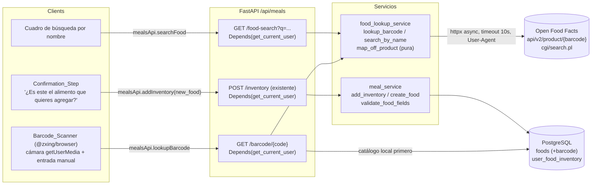

# Design Document: Food Barcode

## Overview

El **Food Barcode** replica la experiencia de "agregar alimento" de MyFitnessPal sobre la feature existente *meal-planner*, sin re-diseñar su modelo de datos. Aporta dos capacidades a la web de HabitTrack:

1. **Lookup / escáner por código de barras.** El usuario escanea el `Barcode` con la cámara o lo escribe a mano; el backend busca primero en el catálogo local (`Food.barcode`) y, si no está, consulta **Open Food Facts**; el resultado se devuelve como un `Food_Candidate` normalizado que el usuario confirma ("¿Es este el alimento que quieres agregar?") antes de agregarlo a su inventario.
2. **Búsqueda por nombre.** El usuario escribe un término; el backend busca en el catálogo local y, como respaldo best-effort, en Open Food Facts; el usuario elige y agrega.

Sobre la arquitectura existente (FastAPI async + SQLAlchemy 2.0 + PostgreSQL + React + OpenRouter) se introduce lo mínimo:

- Una **columna `barcode`** (texto, única, indexada, anulable) en el modelo `Food` ya existente (Req 1).
- Un **servicio de lookup externo** `app/services/food_lookup_service.py` con `httpx` asíncrono, timeout de 10 s y degradación limpia, que mapea la respuesta de Open Food Facts a la forma de `FoodIn` (Req 2, 3, 4).
- **Dos endpoints** nuevos en el router `/api/meals` existente: `GET /api/meals/barcode/{code}` y `GET /api/meals/food-search` (Req 2, 3, 6).
- Un **componente web** de escáner (cámara + entrada manual) y un cuadro de búsqueda por nombre, integrados en `MealsPage`, más métodos nuevos en `mealsApi` (Req 5, 7).

El diseño **reutiliza** los flujos del meal-planner: `validate_food_fields` para los rangos, `create_food`/`add_inventory` para persistir, el patrón de router fino con `Depends(get_current_user)`/`Depends(get_current_admin)`, y los mensajes de error en español. La **separación de privilegios** se conserva: lookup y búsqueda para cualquier usuario autenticado; escritura del catálogo global solo admin; un usuario no admin que confirma un alimento lo agrega a **su propio inventario** vía `add_inventory` (que crea la fila `Food` cuando el nombre no existe), nunca como edición privilegiada del catálogo (Req 6).

### Decisión: endpoints bajo el router `/api/meals` existente (no un nuevo `/api/foods`)

Se añaden `GET /api/meals/barcode/{code}` y `GET /api/meals/food-search` al **router existente `app/routes/meals.py`** en lugar de crear un router `/api/foods` nuevo. Rationale:

- El dominio es el mismo que el meal-planner: catálogo `Food`, inventario `UserFoodInventory`, schemas `FoodIn`/`FoodOut`/`InventoryIn`, y deps `get_current_user`/`get_current_admin` ya viven ahí. Un router separado duplicaría imports y schemas sin beneficio.
- El alta tras la confirmación reutiliza el endpoint ya existente `POST /api/meals/inventory` (con `new_food`), de modo que el flujo "confirmar → agregar" no necesita un endpoint nuevo de escritura. Mantener el lookup/búsqueda en el mismo router preserva la cohesión y la cercanía con esos contratos.
- Evita una segunda superficie de autenticación y de registro de router en `main.py`.

### Fuente de datos externa (verificada): Open Food Facts

Open Food Facts es gratuita, abierta y no requiere clave de API. El `Food_Lookup_Service` usa dos endpoints verificados:

- **Por código de barras (API v2):**
  `https://world.openfoodfacts.org/api/v2/product/{barcode}.json?fields=code,product_name,brands,quantity,serving_size,serving_quantity,nutriments,image_front_small_url`
  Devuelve `status: 1` cuando el producto existe y `status: 0` cuando no.
- **Por nombre (búsqueda):**
  `https://world.openfoodfacts.org/cgi/search.pl?search_terms={q}&json=1&page_size=20&fields=code,product_name,brands,nutriments,image_front_small_url`
  Puede ser lento; se trata como best-effort con timeout y fallback.

Convenciones de uso: enviar siempre un `User-Agent` descriptivo (Open Food Facts lo pide), p. ej. `HabitTrack/1.0 (contacto)`; acotar la espera con un `Lookup_Timeout` de 10 s; nunca propagar un error crudo al router.

Mapeo de `product.nutriments` (campos por 100 g; algunos pueden faltar o ser `None`):

| Campo Open Food Facts (`nutriments`) | Campo Food_Candidate (por 100 g) | Rango catálogo | Nulo permitido |
| --- | --- | --- | --- |
| `energy-kcal_100g` | `kcal` | 0..900 | sí (→ null) |
| `proteins_100g` | `protein` | 0..100 | sí (→ null) |
| `fat_100g` | `fat` | 0..100 | sí (→ null) |
| `carbohydrates_100g` | `carbs` | 0..100 | sí (→ null) |
| `fiber_100g` | `fiber` | 0..100 | sí (→ null) |
| `product.product_name` | `name` (si falta, usar el `barcode`) | 1..100 | no |
| `product.brands` | `brand` (auxiliar, informativo) | — | sí |
| `product.image_front_small_url` | `image_url` (auxiliar, informativo) | — | sí |
| `code` / barcode consultado | `barcode` | 8..14 dígitos | sí |

Nota de validación: Open Food Facts puede devolver valores fuera de los rangos del catálogo (p. ej. kcal > 900 por errores de datos de la comunidad). El mapeo **no valida** rangos; devuelve lo que haya (o `None`). La validación ocurre en el alta (`validate_food_fields`, Req 5.4), de modo que el `Confirmation_Step` muestra el candidato y el error de rango, si lo hubiera, aparece al confirmar en español.

### Design Decisions clave

| Decisión | Rationale | Requisitos |
| --- | --- | --- |
| Endpoints en el router `/api/meals` existente | Mismo dominio (Food/inventario), reutiliza schemas y deps, el alta reusa `POST /inventory`; evita duplicar superficie. | 2, 3, 6 |
| Columna `barcode` **anulable, única, indexada** en `Food` (no tabla nueva) | Extensión mínima; permite reconocer un código en el siguiente escaneo sin consultar la fuente externa; `unique` evita dos alimentos con el mismo código; `nullable` porque la mayoría de los alimentos del seed/manual no tienen código. | 1.1, 1.3, 1.4, 2.1 |
| Migración por columna vía `_migrate_columns` **más** una migración Alembic | Igual patrón que las demás columnas añadidas (p. ej. `users.timezone`): `create_all` no hace `ALTER TABLE`; `_migrate_columns` lo cubre en runtime y Alembic mantiene el historial reproducible. | 1.1 |
| `map_off_product` como **función pura** | El mapeo respuesta→Food_Candidate es la lógica propensa a errores (campos ausentes, `None`, nombre faltante); aislarlo como función pura lo hace testeable con Hypothesis sin red. | 2.3, 2.5, 4.1–4.4 |
| Fuente externa **best-effort** con timeout y degradación | Open Food Facts puede ser lenta/caerse; el lookup devuelve "no disponible" en español y la búsqueda por nombre devuelve igualmente los resultados locales. Nunca un 500 crudo. | 2.8, 3.5 |
| El alta tras confirmar reusa `add_inventory` (no una escritura de catálogo) | Mantiene la separación de privilegios: un usuario no admin solo toca su inventario; `add_inventory` crea la fila `Food` con `new_food` cuando el nombre no existe. | 5.2, 5.3, 6.2, 6.3 |
| Validación de rangos **en el alta**, no en el mapeo | OFF puede traer valores fuera de rango; validarlos en `validate_food_fields` al confirmar da un mensaje en español y preserva el estado. | 5.4 |
| Escáner con `@zxing/browser` + entrada manual | Librería de navegador conocida para decodificar vídeo vía `getUserMedia`; entrada manual como fallback cuando no hay cámara o se deniega el permiso. | 7.1, 7.3, 7.4 |

## Architecture



Flujo de lookup por código de barras (Req 2):

```mermaid
sequenceDiagram
    participant U as Authenticated_User (web)
    participant R as meals router
    participant S as food_lookup_service
    participant DB as DB (foods)
    participant OFF as Open Food Facts

    U->>R: GET /api/meals/barcode/{code}
    R->>R: validar formato (8..14 dígitos; inválido → 400 es, Req 2.6)
    R->>DB: SELECT Food WHERE barcode = code
    alt existe en catálogo local
        DB-->>R: Food
        R-->>U: Food_Candidate (source="local", Req 2.1)
    else no está en el catálogo
        R->>S: lookup_barcode(code)
        S->>OFF: GET api/v2/product/{code}.json (timeout 10s, User-Agent)
        alt timeout / error de red
            OFF--xS: fallo
            S-->>R: ExternalSourceError
            R-->>U: 503 es "fuente externa no disponible" (Req 2.8)
        else status:0 (no encontrado)
            OFF-->>S: status 0
            S-->>R: NotFound
            R-->>U: 404 es "alimento no encontrado" (Req 2.7)
        else status:1 (encontrado)
            OFF-->>S: product
            S->>S: map_off_product(product, code) (pura, Req 4)
            S-->>R: Food_Candidate (source="off")
            R-->>U: Food_Candidate (Req 2.3-2.5)
        end
    end
```

Tras recibir el `Food_Candidate`, la web muestra el `Confirmation_Step`; al confirmar, llama a `POST /api/meals/inventory` con `new_food` (flujo existente), que crea la fila `Food` si hace falta y agrega al inventario del usuario (Req 5, 6).

## Components and Interfaces

### 1. Modelo de datos: columna `barcode` en `Food`

Extensión mínima del modelo existente `app/models/food.py` (una sola columna nueva):

```python
# app/models/food.py (añadir dentro de class Food)
barcode: Mapped[str | None] = mapped_column(
    String(14), unique=True, index=True, nullable=True
)  # EAN/UPC digits; optional; lets a scanned food be recognized next time (Req 1)
```

- `unique=True` evita dos `Food` con el mismo código (Req 1.4). PostgreSQL permite múltiples `NULL` bajo un índice único, de modo que los alimentos sin código (la mayoría) conviven sin conflicto (Req 1.3).
- `index=True` para que el lookup por código sea una búsqueda indexada (Req 1.5).
- `String(14)` cubre EAN-13/UPC-A y variantes de 8..14 dígitos (Req 1.2).

### 2. Servicio de lookup externo: `app/services/food_lookup_service.py`

Nuevo módulo con la lógica de consulta externa y el mapeo puro. Comentarios e identificadores en inglés; mensajes de error en español.

```python
"""Food_Lookup_Service: query Open Food Facts (barcode + name) and map results
to a FoodIn-shaped candidate. External source is best-effort with a 10s timeout
and graceful degradation. User-facing messages are Spanish; code is English."""

import httpx

OFF_PRODUCT_URL = "https://world.openfoodfacts.org/api/v2/product/{code}.json"
OFF_SEARCH_URL = "https://world.openfoodfacts.org/cgi/search.pl"
OFF_PRODUCT_FIELDS = (
    "code,product_name,brands,quantity,serving_size,serving_quantity,"
    "nutriments,image_front_small_url"
)
OFF_SEARCH_FIELDS = "code,product_name,brands,nutriments,image_front_small_url"
LOOKUP_TIMEOUT = 10.0  # seconds (Lookup_Timeout, Req 2.8, 3.5)
USER_AGENT = "HabitTrack/1.0 (https://habittrack.app; soporte@habittrack.app)"
BARCODE_LEN = (8, 14)  # digits


class LookupError(Exception):
    """Base class for Food_Lookup_Service errors (Spanish message to router)."""


class InvalidBarcodeError(LookupError):
    """The barcode is not an 8..14 digit string (Req 2.6)."""


class NotFoundError(LookupError):
    """Open Food Facts has no product for the barcode (status 0) (Req 2.7)."""


class ExternalSourceError(LookupError):
    """Open Food Facts timed out or failed (Req 2.8)."""


def normalize_barcode(code) -> str:
    """Trim surrounding whitespace from a barcode string (Req 1.5)."""


def is_valid_barcode(code) -> bool:
    """True iff code is a string of 8..14 digits after normalization (Req 2.6)."""


def map_off_product(product: dict, fallback_barcode: str) -> dict:
    """PURE. Map an Open Food Facts product dict to a Food_Candidate dict
    (FoodIn-shaped). Missing/None nutriment fields become None; a missing
    product_name falls back to the barcode. Never raises on missing fields
    (Req 2.3, 2.5, 4.1-4.4). Returns:
        {name, barcode, kcal, protein, fat, carbs, fiber, brand, image_url,
         source: "off"}
    """


async def lookup_barcode(code: str) -> dict:
    """Query Open Food Facts for a single barcode. Raises InvalidBarcodeError,
    NotFoundError, or ExternalSourceError (all Spanish via the router). On success
    returns map_off_product(product, code) (Req 2.2, 2.3, 2.7, 2.8)."""


async def search_by_name(query: str) -> list[dict]:
    """Query Open Food Facts search for a name term; return a list of
    Food_Candidate dicts (best-effort). On timeout/error returns [] so the router
    can still return local results (Req 3.2, 3.5)."""
```

`map_off_product` es la única pieza **pura** y la más propensa a errores; se prueba con property tests. Las funciones `async` son I/O (httpx) y se prueban con mocks (sin red).

### 3. Endpoints en `app/routes/meals.py` (router existente)

Dos endpoints nuevos y un schema de respuesta. Ambos requieren `get_current_user` (Req 6.1). Traducen las excepciones del servicio a `HTTPException` con `detail` en español.

```python
# Nuevos schemas en meals.py
class FoodCandidateOut(BaseModel):
    name: str
    barcode: str | None = None
    kcal: float | None = None
    protein: float | None = None
    fat: float | None = None
    carbs: float | None = None
    fiber: float | None = None
    brand: str | None = None
    image_url: str | None = None
    source: str                 # "local" | "off"


# GET /api/meals/barcode/{code}  (Req 2, 6.1)
@router.get("/barcode/{code}", response_model=FoodCandidateOut)
async def lookup_barcode(code, current_user=Depends(get_current_user), db=Depends(get_db)):
    # 1. validar formato (InvalidBarcodeError → 400 es, Req 2.6)
    # 2. catálogo local por barcode normalizado → FoodCandidateOut(source="local") (Req 2.1)
    # 3. si no está, food_lookup_service.lookup_barcode(code):
    #       NotFoundError → 404 es (Req 2.7); ExternalSourceError → 503 es (Req 2.8)
    #       éxito → FoodCandidateOut(source="off") (Req 2.3-2.5)
    ...


# GET /api/meals/food-search?q=...  (Req 3, 6.1)
@router.get("/food-search", response_model=list[FoodCandidateOut])
async def food_search(q, current_user=Depends(get_current_user), db=Depends(get_db)):
    # 1. validar longitud 1..100 (inválido → 400 es, Req 3.4)
    # 2. buscar en el catálogo local por nombre → lista de FoodCandidateOut(source="local")
    # 3. si hay <1 resultado local, añadir food_lookup_service.search_by_name(q)
    #    (best-effort: si falla, devolver solo los locales, Req 3.5)
    ...
```

Mapa de errores (todos con `detail` en español):

| Excepción del servicio | HTTP | Mensaje (es) |
| --- | --- | --- |
| `InvalidBarcodeError` (Req 2.6) | 400 | "El código de barras no es válido. Debe tener entre 8 y 14 dígitos." |
| término de búsqueda inválido (Req 3.4) | 400 | "El término de búsqueda debe tener entre 1 y 100 caracteres." |
| `NotFoundError` (Req 2.7) | 404 | "No encontramos un alimento con ese código de barras." |
| `ExternalSourceError` (Req 2.8) | 503 | "La fuente externa de alimentos no está disponible. Intenta de nuevo." |
| `ValidationError` al confirmar (Req 5.4, reusa `POST /inventory`) | 400 | mensaje de `validate_food_fields` identificando el campo inválido |

El **alta tras confirmar** no es un endpoint nuevo: la web llama al `POST /api/meals/inventory` existente con `new_food` poblado desde el `Food_Candidate`, de modo que `add_inventory` crea la fila `Food` (con `barcode`) si el nombre no existe y la agrega al inventario (Req 5.2, 5.3, 6.2). Para propagar el `barcode` al `Food` creado, el schema `FoodIn` se extiende con un campo opcional `barcode: str | None = None` y `add_inventory`/`create_food` lo persisten (con validación de unicidad, Req 1.4).

### 4. Frontend: escáner, búsqueda y confirmación en `MealsPage`

- **`mealsApi` (`src/lib/api.ts`)**: añadir métodos
  - `lookupBarcode(code: string) => api.get<FoodCandidate>(\`/meals/barcode/${encodeURIComponent(code)}\`)`
  - `searchFood(q: string) => api.get<FoodCandidate[]>(\`/meals/food-search?q=${encodeURIComponent(q)}\`)`
  - e interfaz `FoodCandidate` (name, barcode?, kcal?, protein?, fat?, carbs?, fiber?, brand?, image_url?, source).
  - El alta reusa `addInventory({ food_name, quantity_grams, new_food })` ya existente.
- **`BarcodeScanner` (`src/components/BarcodeScanner.tsx`)**: componente que usa `@zxing/browser` (`BrowserMultiFormatReader`) sobre un `<video>` alimentado por `getUserMedia`. Expone un callback `onDetected(code)`; incluye un campo de entrada manual (input + botón "Buscar código") que dispara el mismo callback. Maneja `NotAllowedError`/`NotFoundError` de `getUserMedia` mostrando un mensaje en español y dejando visible la entrada manual (Req 7.1, 7.3, 7.4). Libera la cámara (stop del stream) al desmontar.
- **`FoodSearchBox`**: input de nombre + botón que llama a `searchFood(q)` y renderiza la lista de `FoodCandidate` (Req 7.5).
- **`FoodConfirm`**: muestra el `Confirmation_Step` con el texto exacto "¿Es este el alimento que quieres agregar?", el nombre, marca, imagen (si hay) y los valores nutricionales editables; botón "Agregar" (llama a `addInventory`) y "Cancelar" (descarta sin cambios) (Req 5.1, 5.5). Si la API responde error de rango al agregar, muestra el `detail` en español conservando el formulario (Req 5.4).
- **Integración**: estas piezas se montan en una sección "Agregar alimento (escáner / búsqueda)" dentro de `MealsPage`, junto a la sección de Inventario existente, con Tailwind dark (tokens `card`, `text-primary`, `text-secondary`, `accent`, `btn-ghost`).

## Data Models

Un único cambio de esquema: la columna `barcode` en la tabla `foods`.

- **`Food.barcode`**: `String(14)`, `unique=True`, `index=True`, `nullable=True`.
- **Migración de columna (runtime, patrón `_migrate_columns`)**: añadir a la lista de `migrations` en `app/database.py`:
  `("foods", "barcode", "VARCHAR(14)", None)` — `create_all` no hace `ALTER TABLE`, así que esto cubre bases ya creadas. El índice único se crea aparte (ver abajo) de forma idempotente.
- **Migración Alembic** (`alembic/versions/..._add_food_barcode.py`): `op.add_column('foods', sa.Column('barcode', sa.String(length=14), nullable=True))` y `op.create_index(op.f('ix_foods_barcode'), 'foods', ['barcode'], unique=True)`; `downgrade` elimina el índice y la columna. `down_revision` apunta a la última migración (`20260612_100000`).

El **`Food_Candidate`** no es una entidad persistida: es un DTO en tránsito (dict en el servicio, `FoodCandidateOut` en el router, `FoodCandidate` en el front). Su forma:

```
Food_Candidate = {
  name: str,                 # product_name o, si falta, el barcode (Req 4.3)
  barcode: str | None,       # 8..14 dígitos
  kcal: float | None,        # energy-kcal_100g (Req 4.1, 4.2)
  protein: float | None,     # proteins_100g
  fat: float | None,         # fat_100g
  carbs: float | None,       # carbohydrates_100g
  fiber: float | None,       # fiber_100g (puede faltar, Req 2.4, 2.5)
  brand: str | None,         # brands (auxiliar, Req 4.4)
  image_url: str | None,     # image_front_small_url (auxiliar, Req 4.4)
  source: "local" | "off"    # origen del candidato (Req 2.1, 2.3)
}
```

## Correctness Properties

*A property is a characteristic or behavior that should hold true across all valid executions of a system-essentially, a formal statement about what the system should do. Properties serve as the bridge between human-readable specifications and machine-verifiable correctness guarantees.*

La única pieza de lógica no trivial y pura de esta feature es `map_off_product` (y los helpers `normalize_barcode`/`is_valid_barcode`): mapea respuestas externas heterogéneas (campos ausentes, `None`, nombre faltante) a un `Food_Candidate` consistente. Es ideal para property-based testing porque su comportamiento varía mucho con la entrada y debe sostener invariantes para TODA respuesta posible. El resto de la feature (endpoints, consultas a BD, escáner web, llamadas httpx) son I/O o UI y se cubren con tests de ejemplo/integración con mocks (ver Testing Strategy).

### Property 1: El mapeo preserva los nutrientes presentes y nulifica los ausentes

*Para toda* respuesta de producto de Open Food Facts, `map_off_product` SHALL producir un `Food_Candidate` cuyos campos `kcal`, `protein`, `fat`, `carbs` y `fiber` sean exactamente el valor numérico del campo por 100 g correspondiente cuando está presente, y `None` cuando el campo está ausente o es `None` en la respuesta.

**Validates: Requirements 2.3, 2.5, 4.1, 4.2**

### Property 2: El nombre siempre está definido (fallback al código de barras)

*Para toda* respuesta de producto de Open Food Facts y todo `barcode` consultado, el `Food_Candidate` resultante de `map_off_product` SHALL tener un `name` no vacío: el `product_name` cuando está presente y no vacío, y el `barcode` consultado en caso contrario.

**Validates: Requirements 4.3**

### Property 3: El mapeo nunca falla y produce la forma completa del candidato

*Para toda* respuesta de producto de Open Food Facts (incluyendo `nutriments` ausente, vacío o parcial y campos auxiliares ausentes), `map_off_product` SHALL retornar sin lanzar excepción un diccionario que contenga todas las claves `name`, `barcode`, `kcal`, `protein`, `fat`, `carbs`, `fiber`, `brand`, `image_url` y `source`.

**Validates: Requirements 2.5, 4.4**

### Property 4: La validación del código de barras acepta exactamente los códigos de 8 a 14 dígitos

*Para toda* cadena de entrada, `is_valid_barcode` aplicado al código normalizado SHALL devolver verdadero si y solo si la cadena normalizada está compuesta únicamente por dígitos y su longitud está entre 8 y 14 inclusive.

**Validates: Requirements 1.2, 2.6**

## Error Handling

- **Formato de código inválido (Req 2.6):** el router valida con `is_valid_barcode` antes de tocar la BD o la red; si falla, responde 400 con un mensaje en español, sin consultar Open Food Facts.
- **Término de búsqueda inválido (Req 3.4):** el router valida la longitud 1..100 antes de consultar; si falla, 400 en español.
- **Producto no encontrado (Req 2.7):** `status: 0` de Open Food Facts se traduce a `NotFoundError` → 404 "No encontramos un alimento con ese código de barras.".
- **Fuente externa no disponible (Req 2.8):** timeout (`httpx.TimeoutException`), error de transporte (`httpx.HTTPError`) o estado HTTP no exitoso se capturan dentro del servicio y se elevan como `ExternalSourceError` → 503 "La fuente externa de alimentos no está disponible. Intenta de nuevo.". Nunca se propaga un 500 crudo.
- **Búsqueda por nombre degradada (Req 3.5):** si `search_by_name` falla o excede el timeout, devuelve `[]`; el router responde con los resultados del catálogo local disponibles (que pueden ser una lista vacía), sin error.
- **Valores fuera de rango al confirmar (Req 5.4):** el alta reusa `add_inventory`, que ejecuta `validate_food_fields`; un valor fuera de rango lanza `ValidationError` → 400 con el mensaje en español del campo inválido, preservando inventario y catálogo.
- **Código de barras duplicado (Req 1.4):** al crear un `Food` con un `barcode` ya existente, la restricción `unique` provoca un `IntegrityError` que `create_food`/`add_inventory` capturan y traducen a `ValidationError` en español ("Ese código de barras ya está asociado a otro alimento."), haciendo rollback para preservar el catálogo.
- **Cámara denegada o ausente (Req 7.4):** en el front, los errores `NotAllowedError`/`NotFoundError`/`NotReadableError` de `getUserMedia` se capturan y muestran un mensaje en español, dejando visible la entrada manual del código.
- **Errores de red del front:** los `detail` en español de la API se muestran al usuario; el formulario de confirmación conserva lo ingresado.

## Testing Strategy

**Enfoque dual.** Property tests para la función pura de mapeo; tests de ejemplo/integración (con mocks, sin red) para el I/O y los endpoints. Marco: `pytest` + `pytest-asyncio` (modo auto) y **Hypothesis** para las propiedades, consistente con el meal-planner. Las llamadas HTTP a Open Food Facts se **mockean** (p. ej. `httpx.MockTransport` o monkeypatch del cliente); los tests **no** acceden a la red.

**Property tests (Hypothesis, mínimo 100 iteraciones).** Cada propiedad del diseño se implementa con un único property test, etiquetado `# Feature: food-barcode, Property N: <texto>`:

- Property 1 → generar `nutriments` con subconjuntos aleatorios de claves presentes/ausentes y valores numéricos o `None`; verificar la correspondencia campo a campo y la nulificación.
- Property 2 → generar productos con y sin `product_name` (incluyendo cadena vacía/espacios) y verificar el fallback al `barcode`.
- Property 3 → generar productos arbitrarios (incl. `nutriments` ausente/vacío y auxiliares ausentes) y verificar que no lanza y que la forma del dict es completa.
- Property 4 → generar cadenas arbitrarias (dígitos, no dígitos, con espacios, de distintas longitudes) y verificar el iff de `is_valid_barcode`.

**Tests de ejemplo/integración (opcionales, con mocks).**

- Endpoint `GET /api/meals/barcode/{code}`: sin token → 401; código inválido → 400 es; hit en catálogo local → `source="local"` sin llamar a la red (mock que falla si se invoca); miss local + mock OFF `status:1` → `source="off"`; mock OFF `status:0` → 404 es; mock timeout/error → 503 es.
- Endpoint `GET /api/meals/food-search`: término inválido → 400 es; resultados locales presentes → no consulta OFF; sin resultados locales + mock OFF con productos → combina; mock OFF que falla → solo locales (sin error).
- Alta tras confirmar vía `POST /api/meals/inventory` con `new_food` que incluye `barcode`: crea `Food` con `barcode` y entrada de inventario; `barcode` duplicado → 400 es y catálogo preservado; valores fuera de rango → 400 es.
- Privacidad/privilegios: lookup y búsqueda funcionan para un usuario no admin (Req 6.1); el alta solo afecta al inventario propio (Req 6.2); `POST/PUT/DELETE /foods` sigue siendo admin-only (Req 6.3).

**Configuración de property tests:** librería Hypothesis (no implementar PBT desde cero); mínimo 100 iteraciones por propiedad; cada test referencia su propiedad del diseño mediante la etiqueta anterior.

## Futuro / fuera de alcance

Las siguientes ideas quedan **fuera del alcance** de esta spec y se documentan para una futura iteración:

- **OCR de la etiqueta nutricional por foto:** reconocer los valores nutricionales a partir de una fotografía de la etiqueta del producto. Requiere un pipeline de visión/OCR y un parseo específico por formato de etiqueta; no se aborda aquí.
- **Recetas con porciones:** definir recetas compuestas por varios alimentos con porciones y derivar su nutrición agregada. Es una extensión del modelo de datos (recetas/ingredientes) que excede la integración mínima con el `Food`/inventario.
- **Escaneo desde Telegram:** esta spec limita el escáner a la web (cámara del navegador + entrada manual). El flujo por Telegram no se aborda.
- **Datos por porción (serving):** el `Food_Candidate` normaliza todo a valores por 100 g; `serving_size`/`serving_quantity` de Open Food Facts se solicitan pero no se usan para calcular por porción en esta iteración.
- **Edición del catálogo global por usuarios no administradores:** se conserva la restricción admin-only del catálogo; cualquier flexibilización queda fuera de alcance.
