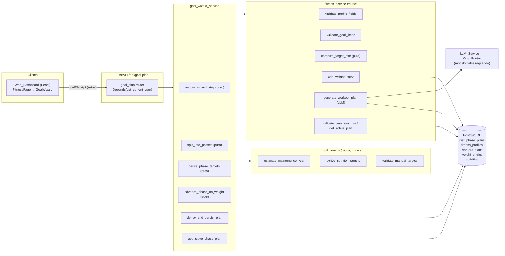
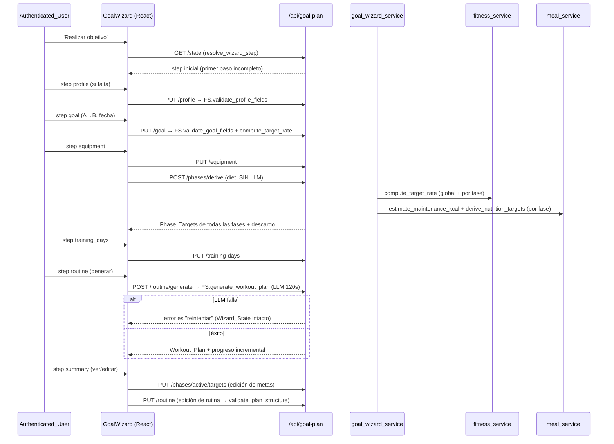
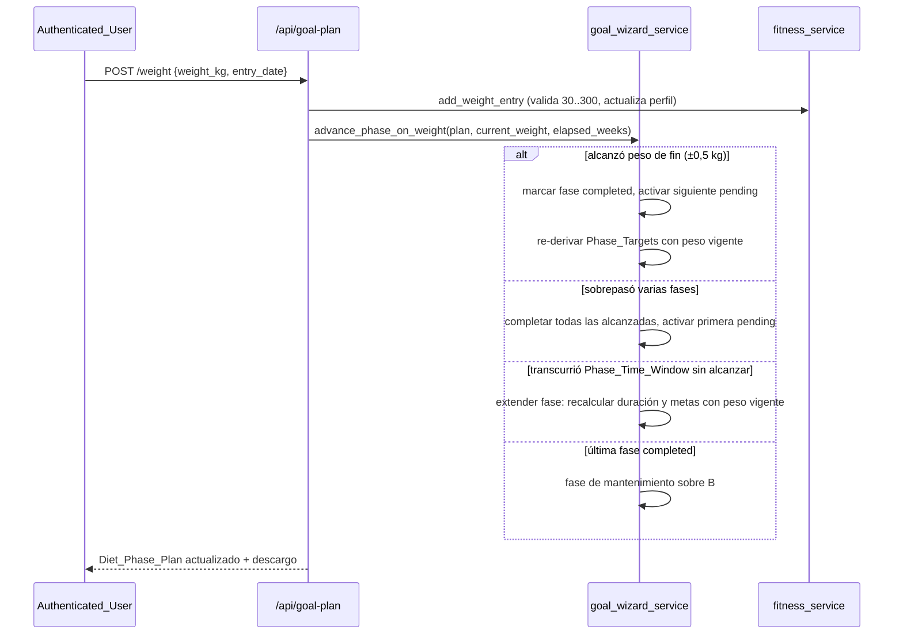
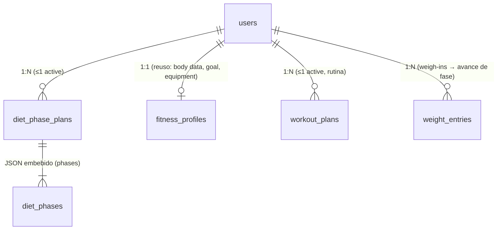

# Design Document: Goal Wizard

## Overview

El **Goal Wizard** añade a HabitTrack un asistente guiado multipaso (en la página Fitness de la web) que lleva al usuario desde un peso actual A hasta un peso objetivo B con una **dieta progresiva por fases** y una **rutina generada por partes**. Sobre la arquitectura existente (FastAPI async + SQLAlchemy 2.0 + PostgreSQL + React 19 + Vite + Tailwind + OpenRouter) se introduce lo mínimo necesario:

- Un **nuevo estado de dominio**: `DietPhasePlan` (1:N con el usuario, a lo más uno activo) con sus `DietPhase` serializadas como JSON en una columna `Text`, igual que `WorkoutPlan.structure`.
- Una **capa de servicio nueva y delgada** (`app/services/goal_wizard_service.py`) con la lógica **pura** de fases (dividir el trayecto, derivar metas por fase, avanzar/re-adaptar fases) construida **encima** de las funciones ya existentes y verificadas.
- Un conjunto reducido de **endpoints** bajo `/api/goal-plan` (ver "Decisión de routing") que orquestan los pasos: guardar perfil (reuso), guardar objetivo (reuso), derivar el plan de fases (puro), consultar el plan activo y la fase actual, avanzar fase al alcanzar peso, generar la rutina (reuso) y editar el resumen.
- Un **componente frontend** `GoalWizard` (máquina de estados multipaso) lanzado desde un botón "Realizar objetivo" en `FitnessPage`, con estados de carga/animación por paso, progreso incremental en la generación de rutina y un resumen final editable, respetando `prefers-reduced-motion`.

El Goal_Wizard **no reinventa**: reutiliza directamente `fitness_service.validate_profile_fields`, `validate_goal_fields`, `compute_target_rate`, `add_weight_entry`, `generate_workout_plan`, `validate_plan_structure`, `get_active_plan`, y las funciones puras `meal_service.estimate_maintenance_kcal` y `derive_nutrition_targets`. La única extensión a lo existente es un `view` enriquecido con datos corporales para alimentar `estimate_maintenance_kcal` (ver "Integración con el código existente").

### La realidad del LLM (explícita en el diseño)

La generación de dieta y rutina depende del LLM de OpenRouter, hoy **poco fiable en el modelo gratuito**: el modelo `qwen` gratuito está limitado por tasa, y `nemotron` razona pero no emite JSON usable y se trunca. **Esta funcionalidad requiere un modelo fiable** (clave propia del usuario en OpenRouter, o un modelo de pago económico) para operar en producción.

El diseño mitiga esto separando lo determinista de lo que necesita LLM:

- **Las metas de dieta por fase (Phase_Targets) son deterministas y puras.** Se calculan con `estimate_maintenance_kcal` + `derive_nutrition_targets` a partir de datos corporales + ritmo de la fase. **No necesitan el LLM.** El paso `diet` del asistente funciona aunque el LLM de plan de comidas esté caído.
- **El plan de comidas día a día (meal plan) es opcional** y queda fuera del flujo obligatorio del asistente (ver "Futuro / fuera de alcance"); solo él y la rutina usan el LLM.
- **La rutina usa `generate_workout_plan`** (LLM, 120 s, reintenta una vez, filtra por equipo). El paso `routine` es su propia llamada de API con su propio estado de carga/animación; si el LLM falla, el usuario recibe un mensaje en español para reintentar y el Wizard_State y los pasos previos se preservan.

### Integración con el código existente (dependencia explícita)

| Símbolo existente (verificado) | Uso en el Goal_Wizard |
| --- | --- |
| `fitness_service.validate_profile_fields` | Validar el paso `profile` (Req 2). |
| `fitness_service.validate_goal_fields` | Validar el paso `goal` para `weight_target` (Req 3). |
| `fitness_service.compute_target_rate(current, target, weeks)` (PURA) | Ritmo global del objetivo y ritmo **por fase** (Req 5, 6). |
| `fitness_service.EQUIPMENT_CATALOG` | Catálogo del paso `equipment` (Req 4). |
| `fitness_service.add_weight_entry` | Detectar el avance de fase vía weigh-in (Req 7). |
| `fitness_service.generate_workout_plan(db, user_id, overrides)` | Paso `routine` (Req 9). |
| `fitness_service.validate_plan_structure` | Edición de rutina en el resumen (Req 10). |
| `fitness_service.get_active_plan` | Mostrar la rutina activa (Req 10). |
| `meal_service.estimate_maintenance_kcal(view)` (PURA) | Mantenimiento TDEE por fase (Req 6). |
| `meal_service.derive_nutrition_targets(view, target_rate)` (PURA) | Phase_Targets por fase, con poscondición ±10 kcal (Req 6). |
| `meal_service.validate_manual_targets` + rangos `MANUAL_*` | Validar edición de metas en el resumen (Req 10). |

**Gap de integración detectado y resuelto.** `FitnessProfile.meal_planner_view()` hoy expone `current_weight_kg`, `target_weight_kg`, `target_date`, `level`, `goal_type`, pero **no** `weight_kg`/`height_cm`/`age`/`sex`, que es exactamente lo que `estimate_maintenance_kcal(view)` lee (`view.get("weight_kg"|"height_cm"|"age"|"sex")`). Para derivar Phase_Targets, el Goal_Wizard construye un **`phase_view`** que combina los datos corporales del perfil con el peso vigente de la fase. Esto evita tocar `meal_planner_view()` (del que depende la feature meal-planner) y mantiene a `estimate_maintenance_kcal` como función pura intacta. El `phase_view` contiene las claves que ambas funciones puras requieren:

```python
# phase_view for a phase whose starting weight is `phase_start_weight`
{
    "weight_kg": phase_start_weight,     # for estimate_maintenance_kcal (BMR)
    "current_weight_kg": phase_start_weight,  # for derive_nutrition_targets (protein/kg)
    "height_cm": profile.height_cm,
    "age": profile.age,
    "sex": profile.sex,
    "goal_type": "weight_target",
    "target_weight_kg": phase_end_weight,
    "target_date": None,
}
```

### Design Decisions clave

| Decisión | Rationale | Requisitos |
| --- | --- | --- |
| **Nueva feature delgada** `goal_wizard_service` encima de fitness/meal | No reinventar: reusa validación, ritmo, weigh-ins, rutina y derivación nutricional ya probados. Solo añade la lógica de fases. | Todo |
| **Routing en `/api/goal-plan`** (router nuevo) en vez de ampliar `/api/fitness` | El plan de fases es un recurso con ciclo de vida propio (derivar, avanzar, consultar, editar). Un prefijo propio mantiene `/api/fitness` enfocado y evita inflar su router; sigue el patrón "un router por dominio". Reusa las funciones del `fitness_service` sin acoplarse a su router. | 1, 11, 12 |
| **Phase_Size_Rule**: ≤ 2,5 kg o ≤ 4 semanas por fase, lo que ocurra primero | Un déficit único para todo A→B es agresivo y el metabolismo se adapta; escalonarlo lo hace sostenible ("no tan cortante de una"). Valores documentados y testeables. | 5.1–5.5 |
| **Phase_Targets puras** (sin LLM) vía `estimate_maintenance_kcal` + `derive_nutrition_targets` | El paso `diet` funciona aunque el LLM esté caído; es matemática determinista por fase. | 6.1–6.4 |
| **Peso vigente al inicio de cada fase** como base de la derivación (no A) | Re-adaptación progresiva: al avanzar/extender fase se re-deriva con el peso real actual. | 6.1, 7.2, 7.3 |
| **Phase_Tolerance = 0,5 kg** en la dirección del objetivo | Un umbral medible de "alcanzó" el peso de fin; evita que el ruido de báscula bloquee el avance. | 7.1, 7.4 |
| **`DietPhasePlan.phases` como JSON en `Text`** | Árbol variable (lista de fases); mismo patrón que `WorkoutPlan.structure`/`MealPlan.structure`. | 11.4 |
| **A lo más un `DietPhasePlan` activo** (flag `active`) | Mismo patrón que `WorkoutPlan.active`/`Goal.active`/`MealPlan.active`. | 5.6, 11.1 |
| **`phase_view` propio** en vez de ampliar `meal_planner_view()` | No romper la dependencia de meal-planner; mantener `estimate_maintenance_kcal` puro. | 6.1, 6.2 |
| **Fase de mantenimiento final** al completar la última fase | Comportamiento documentado para el final del trayecto; evita quedar sin metas. | 7.5 |
| **Máquina de estados en el frontend** con estado persistido en backend | El Wizard_State se reconstruye del estado real (perfil/objetivo/plan) para que reanudar funcione entre sesiones. | 1.2, 1.5, 1.6 |
| **`prefers-reduced-motion`** respetado en las animaciones del paso `diet` | Accesibilidad; alternativa estática equivalente. | 6.6 |

## Architecture



Flujo del asistente (pasos y llamadas de API):



Flujo de avance de fase (vía weigh-in existente):



## Components and Interfaces

### 1. Data Model (SQLAlchemy 2.0)

Nuevo archivo `app/models/diet_phase_plan.py`, registrado en `app/models/__init__.py` e importado en `init_db`.

```python
"""DietPhasePlan: progressive A→B diet split into ordered phases.

At most one active plan per user. The ordered phases live as a JSON tree in a
Text column (same pattern as WorkoutPlan.structure / MealPlan.structure).
User-facing text is Spanish; identifiers and comments are English.
"""
from datetime import datetime
from typing import TYPE_CHECKING

from sqlalchemy import ForeignKey, String, Boolean, Float, Text, func
from sqlalchemy.orm import Mapped, mapped_column, relationship

from app.database import Base

if TYPE_CHECKING:
    from app.models.user import User


class DietPhasePlan(Base):
    __tablename__ = "diet_phase_plans"

    id: Mapped[int] = mapped_column(primary_key=True)
    user_id: Mapped[int] = mapped_column(ForeignKey("users.id"), index=True)

    start_weight_kg: Mapped[float] = mapped_column(Float)   # original A
    target_weight_kg: Mapped[float] = mapped_column(Float)  # final B
    goal_reached: Mapped[bool] = mapped_column(Boolean, default=False)

    # JSON list of phases. Each phase:
    # {"index": int, "start_weight": float, "end_weight": float,
    #  "kcal": float, "protein_g": float, "fat_g": float, "carbs_g": float,
    #  "status": "active"|"completed"|"pending",
    #  "weeks": float, "start_date": str|None, "end_date": str|None,
    #  "maintenance": bool}
    phases: Mapped[str] = mapped_column(Text, default="[]")

    active: Mapped[bool] = mapped_column(Boolean, default=True, index=True)
    created_at: Mapped[datetime] = mapped_column(default=func.now())
    updated_at: Mapped[datetime] = mapped_column(default=func.now(), onupdate=func.now())

    user: Mapped["User"] = relationship(back_populates="diet_phase_plans")

    def phases_list(self) -> list[dict]:
        import json
        try:
            value = json.loads(self.phases or "[]")
            return value if isinstance(value, list) else []
        except (ValueError, TypeError):
            return []

    def active_phase(self) -> dict | None:
        for phase in self.phases_list():
            if phase.get("status") == "active":
                return phase
        return None
```

`User` relationship (edición de `app/models/user.py`, guardada por `TYPE_CHECKING`):

```python
diet_phase_plans: Mapped[list["DietPhasePlan"]] = relationship(
    back_populates="user", cascade="all, delete-orphan"
)
```

### 2. `goal_wizard_service` (`app/services/goal_wizard_service.py`)

Lógica pura primero (sin I/O), luego funciones async con DB. Las excepciones internas (`WizardValidationError`, etc.) las traduce el router a `HTTPException` con `detail` en español. Reutiliza las excepciones de `fitness_service`/`meal_service` cuando aplica.

#### Constantes

```python
PHASE_MAX_KG = 2.5          # Phase_Size_Rule: ≤ 2.5 kg per phase
PHASE_MAX_WEEKS = 4.0       # Phase_Size_Rule: ≤ 4 weeks per phase
PHASE_TOLERANCE_KG = 0.5    # Phase_Tolerance
MIN_PHASE_WEEKS = 1.0       # minimum 1 week per phase

WIZARD_STEPS = ["profile", "goal", "equipment", "diet",
                "training_days", "routine", "summary"]

DISCLAIMER = fitness_service.MEDICAL_DISCLAIMER  # reuse the Spanish disclaimer
```

#### Funciones puras (fases)

```python
def split_into_phases(
    start_weight: float, target_weight: float, rate_kg_per_week: float,
) -> list[dict]:
    """PURE. Split the A→B journey into ordered phases per Phase_Size_Rule.

    Each phase spans at most PHASE_MAX_KG (2.5 kg) OR PHASE_MAX_WEEKS (4 wk),
    whichever comes first. Phase i start_weight == phase i-1 end_weight; phase 0
    start == A; the last phase end == B exactly. If |A-B| <= PHASE_MAX_KG → exactly
    one phase ending at B. ``weeks`` per phase = max(|phase_change|/|rate|,
    MIN_PHASE_WEEKS), capped so the phase does not exceed PHASE_MAX_WEEKS of change.
    Returns a list of phase dicts WITHOUT targets (targets filled by
    derive_phase_targets). Direction (lose vs gain) inferred from sign(B-A)."""

def derive_phase_targets(profile: dict, phase: dict) -> dict:
    """PURE. Return the phase with kcal/protein_g/fat_g/carbs_g filled in.

    Builds a ``phase_view`` (body data + phase start_weight as current weight +
    phase end_weight as target) and a per-phase target_rate via
    fitness_service.compute_target_rate(phase.start_weight, phase.end_weight,
    phase.weeks). Then calls meal_service.derive_nutrition_targets(phase_view,
    target_rate). Guarantees |protein*4 + carbs*4 + fat*9 - kcal| <= 10 kcal
    (post-condition inherited from derive_nutrition_targets)."""

def maintenance_phase(profile: dict, target_weight: float) -> dict:
    """PURE. Build a final maintenance phase at weight B (direction mantenimiento):
    derive_nutrition_targets with no deficit/surplus. status='active',
    maintenance=True."""

def advance_phase_on_weight(
    profile: dict, phases: list[dict], current_weight: float,
    active_elapsed_weeks: float,
) -> list[dict]:
    """PURE. Given the current phases, the user's current weight and how many
    weeks the active phase has been running, return the updated phases:

    - If current_weight reached the active phase end within PHASE_TOLERANCE_KG
      (in the goal direction): mark it completed; mark completed every subsequent
      phase whose end is also reached/overshot; activate the first remaining
      pending phase and re-derive its targets from current_weight (Req 7.1, 7.2, 7.4).
    - Else if active_elapsed_weeks >= active phase weeks and the end weight is not
      reached: EXTEND the active phase — recompute its weeks and targets from
      current_weight (do NOT skip) (Req 7.3).
    - If the last phase becomes completed: append/activate a maintenance phase at
      B and set goal_reached (Req 7.5).
    Pure: operates on dicts, performs no I/O."""

def resolve_wizard_step(profile: dict | None, plan: dict | None,
                        has_routine: bool) -> str:
    """PURE. Return the first incomplete Wizard_Step in WIZARD_STEPS order,
    evaluating profile completeness, goal presence, equipment, derived phases,
    training days and routine presence (Req 1.2, 1.5, 1.6)."""

def is_profile_complete(profile: dict | None) -> bool:
    """PURE. True iff weight_kg/height_cm/age/level/days_per_week/
    minutes_per_session are present and in range (uses validate_profile_fields)."""
```

#### Funciones async (DB)

```python
async def derive_and_persist_plan(db, user_id) -> DietPhasePlan:
    """Load profile+goal (missing/invalid → GoalRequiredError es). Compute the
    global target_rate, split_into_phases, derive_phase_targets for each phase,
    deactivate any previous active plan, persist a new active DietPhasePlan and
    return it (Req 5, 6, 11.1)."""

async def get_active_phase_plan(db, user_id) -> DietPhasePlan | None:
    """Return the user's active DietPhasePlan or None (Req 11.2, 11.3)."""

async def register_weight_and_advance(db, user_id, weight_kg, entry_date) -> dict:
    """Reuse fitness_service.add_weight_entry, then compute elapsed weeks for the
    active phase and call advance_phase_on_weight; persist the updated phases
    (Req 7). Returns the updated plan view + disclaimer."""

async def edit_active_phase_targets(db, user_id, kcal, protein_g, fat_g, carbs_g) -> DietPhasePlan:
    """Validate with meal_service.validate_manual_targets (MANUAL_* ranges);
    on success persist the edited targets onto the active phase (Req 10.2, 10.3)."""

async def generate_routine(db, user_id) -> WorkoutPlan:
    """Thin wrapper over fitness_service.generate_workout_plan(db, user_id); on
    LLM failure the exception propagates unchanged so the router maps it to a
    Spanish retry message and all prior state is preserved (Req 9)."""
```

### 3. Endpoints (`app/routes/goal_plan.py`, prefix `/api/goal-plan`)

Todos con `current_user: User = Depends(get_current_user)` (Req 12.1, 12.2); los datos se filtran por `current_user.id` salvo admin (Req 12.3, 12.4). Registrado en `main.py` como `from app.routes import goal_plan` + `include_router(goal_plan.router, prefix="/api/goal-plan", tags=["GoalWizard"])`.

| Método | Ruta | Request | Response | Requisitos |
| --- | --- | --- | --- | --- |
| GET | `/state` | — | `WizardStateOut{step, profile_complete, has_goal, has_plan, has_routine}` | 1.2, 1.5, 1.6 |
| PUT | `/profile` | `ProfileIn` | `FitnessProfileOut` | 2.1–2.4 |
| PUT | `/goal` | `GoalIn{target_weight_kg, target_date}` | `GoalOut{..., target_rate}` + descargo | 3.1–3.4 |
| PUT | `/equipment` | `EquipmentIn{equipment[]}` | `{equipment[]}` | 4.1–4.3 |
| POST | `/phases/derive` | — | `PhasePlanOut{phases[], active_phase}` + descargo | 5, 6 |
| GET | `/phases` | — | `PhasePlanOut` o `{message}` | 11.2, 11.3 |
| PUT | `/training-days` | `TrainingDaysIn{days_per_week}` | `{days_per_week}` | 8.1–8.3 |
| POST | `/routine/generate` | — | `WorkoutPlanOut` + descargo | 9.1–9.6 |
| PUT | `/routine` | `WorkoutPlanIn{structure[]}` | `WorkoutPlanOut` | 10.4, 10.5 |
| PUT | `/phases/active/targets` | `TargetsIn{kcal, protein_g, fat_g, carbs_g}` | `PhasePlanOut` | 10.2, 10.3 |
| POST | `/weight` | `WeightIn{weight_kg, entry_date}` | `PhasePlanOut` + descargo | 7.1–7.6 |

Ejemplo `POST /api/goal-plan/phases/derive` (A=90, B=80, ~16 semanas):
```json
{
  "phases": [
    {"index": 0, "start_weight": 90.0, "end_weight": 87.5, "weeks": 4.0,
     "kcal": 2180.0, "protein_g": 144.0, "fat_g": 60.4, "carbs_g": 272.9,
     "status": "active", "maintenance": false},
    {"index": 1, "start_weight": 87.5, "end_weight": 85.0, "weeks": 4.0, "status": "pending", "...": "..."},
    {"index": 2, "start_weight": 85.0, "end_weight": 82.5, "weeks": 4.0, "status": "pending", "...": "..."},
    {"index": 3, "start_weight": 82.5, "end_weight": 80.0, "weeks": 4.0, "status": "pending", "...": "..."}
  ],
  "active_phase": {"index": 0, "...": "..."},
  "disclaimer": "Esta información es una estimación orientativa..."
}
```

Ejemplo `GET /api/goal-plan/phases` (sin plan): `{"message": "No tienes un plan de fases activo. Inicia el asistente para crearlo."}`.

### 4. Frontend

**`src/lib/api.ts`** — añadir `goalPlanApi` + interfaces TS (reutilizando `FitnessProfile`, `TargetRate`, `WorkoutPlan`, `WorkoutDay` existentes):

```typescript
export interface DietPhase {
  index: number; start_weight: number; end_weight: number; weeks: number
  kcal: number; protein_g: number; fat_g: number; carbs_g: number
  status: 'active' | 'completed' | 'pending'; maintenance: boolean
}
export interface PhasePlan { phases: DietPhase[]; active_phase: DietPhase | null; disclaimer: string }
export interface WizardState {
  step: 'profile' | 'goal' | 'equipment' | 'diet' | 'training_days' | 'routine' | 'summary'
  profile_complete: boolean; has_goal: boolean; has_plan: boolean; has_routine: boolean
}

export const goalPlanApi = {
  getState: () => api.get<WizardState>('/goal-plan/state'),
  putProfile: (d: Partial<FitnessProfile>) => api.put<FitnessProfile>('/goal-plan/profile', d),
  putGoal: (d: { target_weight_kg: number; target_date: string }) => api.put('/goal-plan/goal', d),
  putEquipment: (d: { equipment: string[] }) => api.put('/goal-plan/equipment', d),
  derivePhases: () => api.post<PhasePlan>('/goal-plan/phases/derive'),
  getPhases: () => api.get<PhasePlan | { message: string }>('/goal-plan/phases'),
  putTrainingDays: (d: { days_per_week: number }) => api.put('/goal-plan/training-days', d),
  generateRoutine: () => api.post<WorkoutPlan>('/goal-plan/routine/generate'),
  putRoutine: (d: { structure: WorkoutDay[] }) => api.put<WorkoutPlan>('/goal-plan/routine', d),
  putActiveTargets: (d: { kcal: number; protein_g: number; fat_g: number; carbs_g: number }) =>
    api.put<PhasePlan>('/goal-plan/phases/active/targets', d),
  postWeight: (d: { weight_kg: number; entry_date: string }) =>
    api.post<PhasePlan>('/goal-plan/weight', d),
}
```

**`src/components/GoalWizard.tsx`** — máquina de estados multipaso (lanzada por un botón "Realizar objetivo" en `FitnessPage`). Un `useReducer` modela el `WizardState`; al montar llama `getState()` para posicionarse en el primer paso incompleto (reanudación entre sesiones). Cada paso es un sub-componente:
- `ProfileStep`, `GoalStep`, `EquipmentStep` (checkboxes del `EQUIPMENT_CATALOG`), `TrainingDaysStep`: formularios que muestran el `detail` de error en español y conservan lo ingresado.
- `DietStep`: dispara `derivePhases()`; mientras resuelve, muestra una **animación temática** (`CookingAnimation`) de ollas/comida con progreso, no un spinner congelado. Respeta `prefers-reduced-motion` (via `window.matchMedia('(prefers-reduced-motion: reduce)')`) mostrando una alternativa estática.
- `RoutineStep`: dispara `generateRoutine()` y muestra **progreso incremental** en español ("Generando rutina... Día 1... Día 2...") con un `RoutineProgress` que avanza etapas simuladas mientras la llamada está en curso; ante fallo, muestra un botón "Reintentar" en español sin perder el Wizard_State.
- `SummaryStep`: muestra las Phase_Targets por fase y la rutina; permite editar metas de la fase activa (`putActiveTargets`) y la rutina (`putRoutine`).

Estilo: Tailwind dark con los tokens establecidos (`card`, `input`, `btn-primary`, `btn-ghost`, `text-text-primary/secondary/dim`, `accent` naranja, `success` verde, `font-display` Barlow Condensed, helper `.display` para números grandes). Sigue la dirección atlética ya establecida en `FitnessPage`.

**`src/components/CookingAnimation.tsx`** — animación CSS/SVG de ollas/comida para el paso `diet`, con fallback estático bajo `prefers-reduced-motion`.

**`src/pages/FitnessPage.tsx`** — añadir el botón "Realizar objetivo" (prominente) que abre `GoalWizard` (modal o vista a pantalla completa).

### 5. Migración

Dos redes de seguridad, consistente con el proyecto:
1. **`create_all` idempotente**: importar `diet_phase_plan` en `init_db` y registrar `DietPhasePlan` en `app/models/__init__.py`. `create_all` crea `diet_phase_plans` si no existe.
2. **Migración Alembic** encadenada tras `20260613_100000`: `create_table("diet_phase_plans", ...)` con índices en `user_id` y `active`. Como es una tabla nueva (no columnas añadidas a una existente), no requiere una entrada en `_migrate_columns`; aun así, por consistencia con el proyecto, se documenta que `_migrate_columns` solo cubre ALTER TABLE de tablas existentes y aquí no aplica.

## Data Models

### Tabla nueva: `diet_phase_plans`

| Columna | Tipo | Notas |
| --- | --- | --- |
| id | PK int | |
| user_id | FK users.id, index | 1:N (Req 11) |
| start_weight_kg | float | peso original A |
| target_weight_kg | float | peso final B |
| goal_reached | bool default false | fijado al completar la última fase (Req 7.5) |
| phases | text default `'[]'` | JSON lista de Diet_Phase (Req 11.4) |
| active | bool, index, default true | a lo más 1 activo (Req 5.6, 11.1) |
| created_at / updated_at | datetime | |

Forma de cada Diet_Phase dentro de `phases`:

| Campo | Tipo | Notas |
| --- | --- | --- |
| index | int | orden 0..n |
| start_weight | float | = end_weight de la fase anterior; fase 0 = A |
| end_weight | float | avanza hacia B; última fase = B exacto |
| weeks | float | duración estimada ≥ 1 |
| kcal / protein_g / fat_g / carbs_g | float | Phase_Targets (Req 6.3) |
| status | str | `active` \| `completed` \| `pending` |
| maintenance | bool | true solo en la fase de mantenimiento final |
| start_date / end_date | str\|null | fechas ISO estimadas (opcionales) |

### Relaciones



## Correctness Properties

*A property is a characteristic or behavior that should hold true across all valid executions of a system-essentially, a formal statement about what the system should do. Properties serve as the bridge between human-readable specifications and machine-verifiable correctness guarantees.*

Estas propiedades aplican a la lógica **pura** de fases (`split_into_phases`, `derive_phase_targets`, `advance_phase_on_weight`, `resolve_wizard_step`), a los invariantes de estado persistido (≤1 plan activo, round-trip JSON) y a la forma de las respuestas (descargo, ordenamiento). Las capas de I/O (LLM de rutina, render/animación UI, auth) se cubren con tests de ejemplo/integración/component (ver Testing Strategy). Tras la prework se consolidaron propiedades redundantes: los invariantes del split (5.1–5.5) se agrupan en la Property 2; la derivación por fase (6.1, 6.3, 6.4) en la Property 3; y la privacidad (12.3, 12.4) en la Property 11.

### Property 1: Resolución del paso inicial del asistente

*For any* combinación de estado del usuario (perfil completo o incompleto, con o sin objetivo, con o sin equipo, con o sin plan de fases, con o sin días de entrenamiento, con o sin rutina), `resolve_wizard_step` debe devolver el primer Wizard_Step en el orden `profile, goal, equipment, diet, training_days, routine, summary` cuyos datos requeridos aún no estén completos; en particular, si el perfil ya es Profile_Complete el paso resultante no debe ser `profile`.

**Validates: Requirements 1.2, 1.5, 1.6**

### Property 2: Invariantes del fraccionamiento en fases

*For any* peso inicial A y peso objetivo B en el rango 30–300 kg con A distinto de B, y cualquier ritmo semanal distinto de cero, el resultado de `split_into_phases` debe satisfacer: cada fase abarca a lo más 2,5 kg de cambio de peso y a lo más 4 semanas de duración estimada; el peso de inicio de la primera fase es A y el de cada fase posterior es el peso de fin de la anterior; los pesos de fin avanzan monótonamente hacia B sin sobrepasarlo; el peso de fin de la última fase es exactamente B; la duración de cada fase es al menos 1 semana; y cuando el valor absoluto de A menos B es menor o igual a 2,5 kg el resultado contiene exactamente una fase que termina en B.

**Validates: Requirements 5.1, 5.2, 5.3, 5.4, 5.5**

### Property 3: Derivación determinista de metas por fase y poscondición de macros

*For any* perfil con datos corporales válidos y cualquier fase con pesos de inicio y fin y duración válidos, `derive_phase_targets` debe ser determinista (la misma entrada produce siempre la misma salida sin invocar al LLM_Service), debe producir las cuatro metas numéricas `kcal`, `protein_g`, `fat_g` y `carbs_g`, y debe cumplir que el valor absoluto de `protein_g*4 + carbs_g*4 + fat_g*9 - kcal` no exceda 10 kcal.

**Validates: Requirements 6.1, 6.3, 6.4**

### Property 4: El ritmo de cada fase corresponde a la fase, no al trayecto completo

*For any* fase con pesos de inicio y fin y duración, el ajuste calórico diario incorporado en las metas de la fase debe corresponder al `Target_Rate` calculado por `compute_target_rate` sobre el cambio de peso y la duración de esa fase, y no al `Target_Rate` del trayecto completo A→B.

**Validates: Requirements 6.2**

### Property 5: La respuesta de dieta incluye todas las fases con metas y descargo

*For any* objetivo A→B válido, la respuesta de derivación de dieta debe incluir todas las fases del plan, cada una con sus cuatro metas numéricas, y un descargo médico en español no vacío.

**Validates: Requirements 6.7**

### Property 6: La respuesta de objetivo incluye el ritmo y el descargo

*For any* objetivo `weight_target` válido, la respuesta del paso de objetivo debe incluir un `Target_Rate` con `rate_kg_per_week`, `daily_kcal_delta` y `direction`, y un descargo médico en español no vacío.

**Validates: Requirements 3.4**

### Property 7: Avance de fase al alcanzar el peso de fin

*For any* plan de fases con una fase activa y un peso vigente que alcanza el peso de fin de la fase activa dentro de la Phase_Tolerance de 0,5 kg en la dirección del objetivo, `advance_phase_on_weight` debe marcar esa fase como `completed`, activar la primera fase `pending` restante, y asignar a la nueva fase activa un peso de inicio igual al peso vigente con sus metas re-derivadas desde ese peso.

**Validates: Requirements 7.1, 7.2**

### Property 8: Extensión de la fase ante progreso insuficiente

*For any* plan de fases cuya fase activa ha superado su Phase_Time_Window sin que el peso vigente haya alcanzado el peso de fin dentro de la tolerancia, `advance_phase_on_weight` debe mantener esa fase como `active` (sin activar ninguna fase `pending`) y recalcular su duración estimada y sus metas a partir del peso vigente.

**Validates: Requirements 7.3**

### Property 9: Salto múltiple al sobrepasar varias fases

*For any* plan de fases y un peso vigente que sobrepasa el peso de fin de una o más fases más allá de la tolerancia en la dirección del objetivo, `advance_phase_on_weight` debe marcar como `completed` todas las fases cuyo peso de fin fue alcanzado o sobrepasado y dejar como `active` únicamente la primera fase `pending` restante.

**Validates: Requirements 7.4**

### Property 10: Fase de mantenimiento al completar el trayecto

*For any* plan de fases en el que el peso vigente alcanza o sobrepasa el peso de fin de la última fase, `advance_phase_on_weight` debe producir una fase de mantenimiento activa cuyo peso objetivo es B y cuya derivación usa dirección de mantenimiento, y debe marcar el objetivo como alcanzado.

**Validates: Requirements 7.5**

### Property 11: Round-trip de persistencia del plan de fases

*For any* plan de fases válido, serializar sus fases a JSON y volver a leerlas mediante `phases_list` debe producir una lista de fases equivalente, con los mismos índices, pesos, metas y estados.

**Validates: Requirements 7.6, 11.4**

### Property 12: A lo más un plan de fases activo por usuario

*For any* secuencia de derivaciones de plan de fases para un usuario, tras cada derivación debe existir exactamente un `DietPhasePlan` activo para ese usuario y todos los planes anteriores del usuario deben quedar inactivos.

**Validates: Requirements 5.6, 11.1**

### Property 13: Consulta con fases ordenadas por índice

*For any* plan de fases activo, la consulta del plan debe devolver sus fases ordenadas de forma ascendente por índice y señalar correctamente la fase activa actual.

**Validates: Requirements 11.2**

### Property 14: Preservación del estado ante fallo de generación de rutina

*For any* modo de fallo del LLM_Service durante la generación de rutina (tiempo de espera, error, respuesta vacía o contenido no interpretable), el Fitness_Profile, el objetivo, el `DietPhasePlan` y el `WorkoutPlan` activo previo del usuario deben permanecer sin cambios.

**Validates: Requirements 9.3, 9.4**

### Property 15: Privacidad — solo registros propios

*For any* par de usuarios distintos no administradores, cada operación del Goal_Wizard debe leer y modificar únicamente los registros pertenecientes al usuario solicitante, y toda solicitud de un usuario no administrador sobre el plan de fases, el perfil o la rutina de otro usuario debe rechazarse sin exponer esos datos.

**Validates: Requirements 12.3, 12.4**

### Property 16: Descargo médico en respuestas con metas o rutina

*For any* respuesta del Goal_Wizard que contenga Phase_Targets o un Workout_Plan, la respuesta debe incluir un descargo en español no vacío que indique que la información es orientativa y no constituye consejo ni diagnóstico médico.

**Validates: Requirements 12.5**

## Error Handling

Excepciones internas del servicio traducidas por el router a `HTTPException` con `detail` en español. El Goal_Wizard reutiliza las excepciones de `fitness_service` (`ValidationError`, `GoalRequiredError`, `EquipmentError`, `LLMError`) y `meal_service` (`ValidationError`) cuando corresponde.

| Situación | Excepción interna | HTTP | Mensaje (es) | Requisitos |
| --- | --- | --- | --- | --- |
| Campo de perfil fuera de rango/formato | `fitness_service.ValidationError` | 400/422 | Identifica el campo y su rango | 2.3 |
| Objetivo inválido (fecha ≤ hoy, peso fuera de rango) | `fitness_service.ValidationError` | 400 | Identifica el campo inválido | 3.3 |
| Equipo fuera del catálogo | `fitness_service.ValidationError` | 400 | Identifica el equipo inválido | 4.3 |
| Días de entrenamiento fuera de 1..7 | `fitness_service.ValidationError` | 400 | Indica el rango 1 a 7 | 8.3 |
| Derivar fases sin perfil/objetivo | `fitness_service.GoalRequiredError` | 400 | "Primero completa tu perfil y objetivo para generar tu plan." | 5, 6 |
| Metas editadas fuera de rangos `MANUAL_*` | `meal_service.ValidationError` | 400 | Lista cada campo y su rango | 10.3 |
| Rutina editada con estructura inválida | `fitness_service.ValidationError` | 400 | Describe la estructura inválida | 10.5 |
| LLM timeout (>120s) / error / sin respuesta / no interpretable | `fitness_service.LLMError` | 502/503 | "No pudimos generar tu rutina en este momento. Intenta de nuevo." | 9.3, 9.4 |
| Consulta de plan de fases sin plan activo | (no error) | 200 | `{message: "No tienes un plan de fases activo. Inicia el asistente para crearlo."}` | 11.3 |
| Solicitud sin JWT válido | (dependencia `get_current_user`) | 401 | "No autenticado" | 12.1, 12.2 |
| No admin accede a datos de otro usuario | `HTTPException` | 403/404 | Sin exponer datos ajenos | 12.3, 12.4 |

Principios:
- **Validar antes de mutar**: cada función que cambia estado valida por completo antes de persistir; ante cualquier fallo del LLM o validación, el plan de fases, el perfil, el objetivo y la rutina activa quedan intactos (Req 9.3, 9.4, 10.3, 10.5).
- **Lógica pura separada de la persistencia**: `split_into_phases`, `derive_phase_targets` y `advance_phase_on_weight` no hacen I/O; las funciones async solo orquestan y persisten el resultado. Esto hace que un fallo de LLM en el paso `routine` no pueda corromper el plan de fases ya derivado.
- **Descargos**: las respuestas de `/goal`, `/phases/derive`, `/phases`, `/routine/generate`, `/routine` y `/weight` incluyen `disclaimer` en español (Req 3.4, 6.7, 12.5).
- **Frontend**: el `GoalWizard` muestra el `detail` en español devuelto por la API, conserva lo ingresado y preserva el Wizard_State ante fallos del paso `routine` (Req 9.3).

## Testing Strategy

Marco existente del proyecto: **pytest** con **pytest-asyncio** (modo auto), **pytest-cov** e **Hypothesis** (ya presente, carpeta `.hypothesis/`). Los tests van en `tests/`. El frontend usa component tests (según el patrón ya usado en `src/`).

### Enfoque dual

- **Property tests (Hypothesis)**: validan las propiedades universales sobre la lógica **pura** de fases y los invariantes de estado. PBT es apropiado aquí porque `split_into_phases`, `derive_phase_targets`, `advance_phase_on_weight` y `resolve_wizard_step` son funciones puras con entrada/salida clara y un espacio de entrada amplio (pesos, ritmos, duraciones, combinaciones de estado), y porque el round-trip de serialización del plan de fases es un caso clásico de PBT.
- **Unit/example tests**: casos concretos, lecturas CRUD, y verificación de wiring por paso (cada endpoint acepta válidos y rechaza inválidos preservando el estado previo).
- **Integration tests (con mock del LLM)**: la generación de rutina depende de OpenRouter; se prueba con `fitness_service.generate_workout_plan`/`llm_service` mockeado (respuesta válida, timeout, error, JSON malformado). **No** se hace PBT sobre la llamada al LLM en sí (servicio externo, alto costo); sí sobre la preservación de estado ante fallo (Property 14, con mocks).
- **Component tests (frontend)**: `GoalWizard` y sus pasos (presencia de botón "Realizar objetivo", render de catálogo de equipo, animación del paso `diet` con y sin `prefers-reduced-motion`, progreso incremental del paso `routine`, resumen editable). La UI no usa PBT (render/interacción).

### Configuración de property tests

- Librería: **Hypothesis** (no implementar PBT desde cero).
- Mínimo **100 iteraciones** por property test (`@settings(max_examples=100)`).
- Cada property test se etiqueta con un comentario referenciando la propiedad del diseño:
  `# Feature: goal-wizard, Property N: <texto de la propiedad>`.
- Cada propiedad de la sección Correctness Properties se implementa con **un único** property test.

### Mapa propiedad → función bajo prueba

| Propiedad | Función / capa | Tipo |
| --- | --- | --- |
| 1 | `resolve_wizard_step` (pura) | Hypothesis |
| 2 | `split_into_phases` (pura) | Hypothesis |
| 3 | `derive_phase_targets` (pura) | Hypothesis |
| 4 | `derive_phase_targets` (ritmo por fase) | Hypothesis |
| 5 | respuesta de `/phases/derive` | Hypothesis + DB |
| 6 | respuesta de `/goal` | Hypothesis + DB |
| 7 | `advance_phase_on_weight` (avance) | Hypothesis |
| 8 | `advance_phase_on_weight` (extensión) | Hypothesis |
| 9 | `advance_phase_on_weight` (salto múltiple) | Hypothesis |
| 10 | `advance_phase_on_weight` (mantenimiento) | Hypothesis |
| 11 | `DietPhasePlan.phases_list` round-trip | Hypothesis |
| 12 | `derive_and_persist_plan` (≤1 activo) | Hypothesis + DB |
| 13 | `get_active_phase_plan` / `GET /phases` | Hypothesis + DB |
| 14 | `generate_routine` fallos (mock LLM) | Hypothesis + mock |
| 15 | endpoints `/api/goal-plan/*` privacidad | Hypothesis + DB |
| 16 | respuestas con metas/rutina | Hypothesis |

### Tests de ejemplo / integración / component

- **Endpoints y auth**: cada endpoint sin token → 401; token válido → 200 (Req 12.1, 12.2).
- **Pasos (wiring)**: `PUT /profile`, `/goal`, `/equipment`, `/training-days` aceptan válidos (persisten) y rechazan inválidos (400 es, estado previo intacto) (Req 1.3, 2.2, 2.3, 3.2, 3.3, 4.2, 4.3, 8.2, 8.3).
- **Reanudación**: `GET /state` posiciona en el primer paso incompleto desde el estado persistido (Req 1.6).
- **Edición en resumen**: `PUT /phases/active/targets` y `PUT /routine` válidos persisten; inválidos → 400 es con estado previo intacto (Req 10.2–10.5).
- **Generación de rutina (mock LLM)**: válido → plan persistido y activo, no excede `days_per_week` (Req 9.1, 9.6); timeout/None/JSON inválido/error → 502 es + estado preservado y reintento sin reingresar datos (Req 9.3, 9.5).
- **Plan de fases sin plan**: `GET /phases` → mensaje es (Req 11.3).
- **Component tests**: botón "Realizar objetivo" presente (Req 1.1); `ProfileStep`/`GoalStep`/`EquipmentStep`/`TrainingDaysStep` muestran errores en español y conservan datos (Req 1.4, 2.1, 3.1, 4.1, 8.1); `DietStep` anima mientras carga y respeta `prefers-reduced-motion` (Req 6.5, 6.6); `RoutineStep` muestra progreso incremental (Req 9.2); `SummaryStep` muestra metas por fase y rutina y permite editar (Req 10.1).

### Balance

Los property tests cubren la corrección universal (fraccionamiento en fases, derivación determinista con poscondición de macros, transiciones de avance/extensión/salto/mantenimiento, round-trip, invariante de ≤1 plan activo, privacidad, descargo); los tests de ejemplo/integración/component cubren wiring por paso, lecturas simples, la dependencia externa (LLM, con mocks) y la UI (animación, progreso incremental, accesibilidad). Se evita multiplicar unit tests donde una propiedad ya cubre el espacio de entrada, y se evita PBT sobre la llamada al LLM y sobre el render de UI.

## Futuro / fuera de alcance

Las siguientes ideas quedan **fuera del alcance** de esta spec y se documentan para una futura iteración:

- **Asistente desde Telegram:** esta spec limita el Goal_Wizard a la web (página Fitness + componente `GoalWizard`). Un flujo guiado equivalente por Telegram (con el mismo plan de fases) queda fuera de alcance.
- **Detección automática de estancamiento (plateau):** esta spec detecta el avance de fase mediante el weigh-in explícito del usuario y re-adapta por tiempo transcurrido. Inferir automáticamente un plateau a partir de los datos de actividad (`activities`) o de la tendencia de peso sin un weigh-in explícito queda fuera de alcance.
- **Ciclado de macros (carb cycling):** las Phase_Targets usan el reparto fijo 4/4/9 de `derive_nutrition_targets`. Variar los macros por día (p. ej. días altos/bajos en carbohidratos) dentro de una fase queda fuera de alcance.
- **Plan de comidas día a día como paso obligatorio:** el paso `diet` entrega las Phase_Targets deterministas. El plan de comidas día a día por LLM (`meal_service.generate_meal_plan`) es opcional y no forma parte del flujo obligatorio del asistente; se integra con la feature meal-planner existente cuando el LLM es fiable.
- **Modelo de LLM fiable como configuración gestionada por el usuario:** esta spec documenta que la generación de rutina requiere un modelo fiable (clave propia de OpenRouter o modelo de pago), pero no incluye una UI para que el usuario configure su propia clave/modelo; esa gestión de credenciales queda fuera de alcance.
